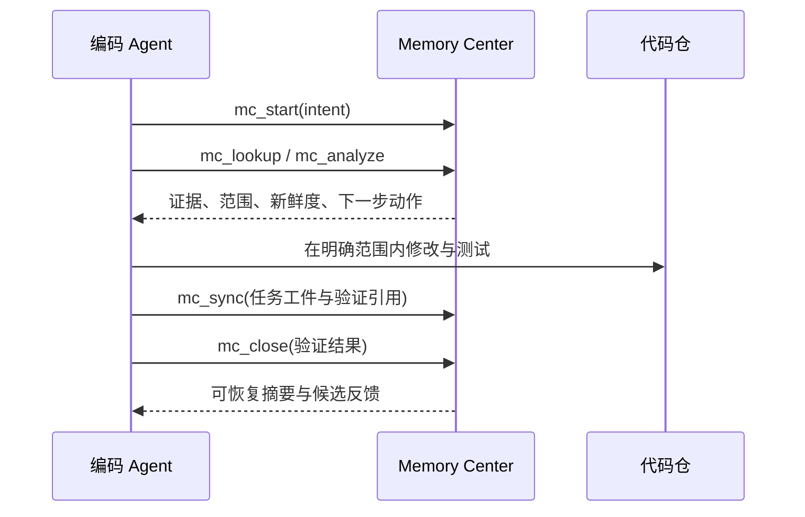
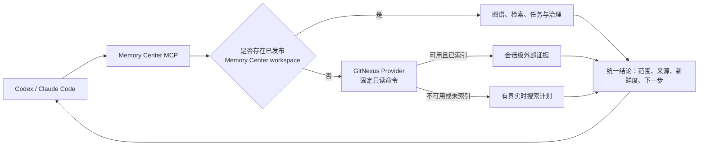

# Memory Center 面试技术讲解手册

> 面向 30 至 60 分钟技术面试和架构评审。本文以 `4.3.50` 已实现能力为准；规划项会明确标注为“后续方向”，不与现状混淆。
>
> English summary: an interview-ready technical narrative for a local-first, graph-first engineering context system for AI coding agents.
>
> **文档类型 / Document type：技术架构讲解。** 本文自包含地说明技术场景、架构取舍、核心机制、性能边界、安全治理、开源吸收策略和后续演进方向。

---

## 1. 开场：两分钟讲清楚

### 1.1 一句话定位

Memory Center 是一个面向 AI 编程助手的**本地优先工程上下文系统**。它把多仓、多服务代码中的结构、调用、契约、配置、任务过程和验证证据，组织成可重建、可检索、可解释、可治理的工程知识底座，并通过 MCP、CLI、HTTP 和 Workbench 提供给 Agent 与研发人员。

它不是聊天记录库，也不是单纯的向量数据库，更不是替代 IDE 的代码搜索工具。它解决的是：在复杂工程里，Agent 如何在不反复全局搜索、不把猜测当事实的前提下，可靠完成跨服务变更。

### 1.2 业务痛点

我把问题拆成五类：

| 问题 | 传统 Agent 的表现 | 造成的工程风险 | 系统做法 |
|---|---|---|---|
| 上下文断裂 | 新会话从头读代码 | 重复搜索、结论不一致 | Session、Task、Resume、Handoff |
| 跨服务链路不透明 | 找到一个 Controller 就停止 | 漏掉 Feign、MQ、DTO、配置调用方 | 静态事实图谱与有限深度链路展开 |
| 空结果被误读 | “搜不到”被当作“不存在” | 错误否定结论 | `knowledge_state`、范围和下一步动作 |
| 索引陈旧或更新太慢 | 全量重建阻塞工作 | 延迟高、结果过期 | generation、暂存发布、定向刷新 |
| 经验不受控 | 模型自评成功即沉淀 | 错误做法被复用 | 证据门槛、canary、发布与回滚 |

### 1.3 推荐的开场表达

> “我的核心设计不是让模型记住更多文本，而是把工程中可验证的事实提前建模：代码、接口、消息、配置和验证记录形成图谱。查询时先利用精确事实与图关系，再按需使用全文和语义召回；结论必须带证据范围、索引版本和可信状态。这样 Agent 的能力从临时搜索，变成可追溯的工程工作流。”

---

## 2. 总体架构：从代码到可控 Agent


### 2.1 分层与职责

| 层 | 核心职责 | 关键原则 |
|---|---|---|
| Workspace | 多项目范围、服务识别、规则、宿主接入 | 先定义边界，再索引 |
| Indexing | 文件、符号、Spring 语义、调用关系提取 | 事实提取与推断分离 |
| Storage | 图谱、倒排、向量、稀疏治理覆盖层 | 本地可重建、单一读写契约 |
| Retrieval | 查询规划、候选召回、融合排序、证据预算 | 精确事实优先，成本有界 |
| Orchestration | 影响分析、任务状态、交接、验证闭环 | Agent 使用任务接口而非底层细节 |
| Governance | 证据等级、断言状态、审计、发布门禁 | 不把不确定结论伪装成事实 |
| Adapters | MCP、CLI、HTTP、Workbench、Hooks | 四入口语义一致 |

### 2.2 数据面与控制面分离

这是架构中最重要的划分。

- **数据面**：图节点、图边、倒排/BM25、向量索引。这些内容服务查询，来源可重建。
- **控制面**：索引 generation、暂存发布、刷新任务、策略、断言覆盖、门禁和审计。它决定什么数据可以被读取、什么结论可以被提升。
- **经验面**：任务工件、验证回执、Skill 候选。它不能反向篡改静态事实，只能提供有证据的操作建议。

这样可以避免两个常见问题：一是把模型推断写成代码事实；二是把昂贵的索引维护放到查询热路径。

---

## 3. 代码事实图谱：为什么不只做 RAG

### 3.1 实体与关系

系统将工程对象规范化为节点，例如：`Service`、`File`、`Class`、`Method`、`Field`、`Endpoint`、`FeignClient`、`FeignMethod`、`MQTopic`、`MQConsumer`、`ConfigKey`、`DataResource`。

关系表达真实工程约束，例如：

```text
Service --CONTAINS--> File --DECLARES--> Class --DECLARES--> Method
Controller --HANDLES_ENDPOINT--> Endpoint
FeignMethod --CALLS_SERVICE--> Endpoint
MQConsumer --CONSUMES_TOPIC--> MQTopic
Method --READS_CONFIG--> ConfigKey
Method --USES_DATA_RESOURCE--> DataResource
Method --CALLS_METHOD--> Method
```

图谱的价值不是“看起来很高级”，而是能回答关键词搜索无法稳定回答的问题：

- 这个 DTO 改动会影响哪些 Feign、Controller 和消费者？
- 这条请求从入口到下游服务、实现类、消息处理的链路是什么？
- 一个配置键在什么服务、什么方法被读取？
- 某个接口的调用方和被调用方是否跨项目？

### 3.2 解析器与置信度

Java/Spring 解析以 tree-sitter 为优先路径，并保留可诊断的降级能力。系统不会把静态调用分析当作绝对真相：每条调用候选可包含置信度和原因，用于区分明确解析、命名推断和歧义匹配。

面试时要强调：静态分析对反射、动态代理、运行期拼接并不完备。因此系统把“静态事实候选”“推断”“运行时验证”分开表达，而不是承诺调用图 100% 完整。

### 3.3 事实、推断与验证

| 证据等级 | 含义 | 示例 |
|---|---|---|
| `EXTRACTED` | 从源码、配置或受控输入直接提取 | 注解路由、Feign 名称、Kafka topic |
| `INFERRED` | 根据图关系或规则推导 | 多跳影响范围、候选实现类 |
| `AMBIGUOUS` | 存在多个合理候选，不能自动裁决 | 同名方法、多 Controller 候选 |
| `VERIFIED` | 有验证证据支持 | 人工确认、受控测试、运行时兼容结果 |

结论还携带 `knowledge_state`：`FOUND`、`NOT_FOUND`、`UNKNOWN`、`NOT_INDEXED`、`STALE`、`REJECTED`。无结果只代表“在当前范围未发现”或“证据不足”，不能说“系统不存在这个影响”。

---

## 4. 索引与新鲜度：如何避免又慢又旧

### 4.1 generation 发布模型

索引不直接覆盖正在服务查询的数据。一次重建遵循：

```text
扫描范围 -> 解析与写入 staging generation -> 质量检查
-> 原子激活为 published generation -> 查询读取新 generation
```

好处是：索引构建失败不会污染线上查询；查询永远读取一版完整可解释的视图；结果可以回溯到 generation。

### 4.2 变化感知与定向刷新

真实工程频繁变化，全量 reindex 放在每次查询前必然导致卡顿。Memory Center 的原则是：

1. 用变更路径判断是否可能影响索引。
2. 合并短时间内连续变化，去抖后按项目和路径定向刷新。
3. 查询先读取当前 published generation，并返回新鲜度。
4. 高成本全量重建只由显式命令或发布/基准任务触发。

因此“自动最新”不是每次都扫全仓，而是针对相关路径做最小必要刷新；当证据表明索引可能过期时，返回 `STALE` 和明确动作，而不是静默使用旧结论。

### 4.3 存储空间控制

图谱和索引是可重建派生物，不应该无限复制。当前设计将静态断言从图边按需派生，SQLite 断言侧车只保存人工验证、拒绝和治理等稀疏覆盖；语义内容只保存元数据，BM25/ANN 直接从专用索引读取。这样避免同一静态事实在图、JSONL 和断言表中多次全量复制。

面试追问“为什么本地索引会很大”时，回答应是：大仓的关系边和向量天然有成本，正确方案不是删除事实，而是减少重复物化、隔离可重建派生物、提供压缩与 vacuum，并让向量只覆盖有价值的候选范围。

---

## 5. 检索算法：为什么是混合检索而不是单模型

### 5.1 查询规划先于检索

查询先根据意图生成有界计划，而不是对所有数据源盲目搜索。

| 查询类型 | 优先证据源 | 避免的无效成本 |
|---|---|---|
| 精确符号、接口、配置 | 图索引、符号索引、精确匹配 | 不启动向量检索 |
| 全链路分析 | 图遍历、调用与契约边 | 不用语义召回淹没主链路 |
| 自然语言定位 | BM25、稀疏语义、可选 dense | 保留精确命中锚点 |
| 索引过期 | 新鲜度检查、受限 live read | 不把旧索引说成最新 |

### 5.2 多路召回与融合

检索可组合以下来源：

- 图结构：最适合调用、依赖、配置、消息等确定关系。
- 精确匹配：最适合类名、方法名、接口路径、topic、配置键。
- SQLite FTS/BM25：最适合技术名词和自然语言中的稀疏关键词。
- 可选本地 dense vector：补足表达差异。
- 可选重排：仅用于有限候选的精排，不能覆盖精确事实锚点。

排序遵循“硬约束优先、学习权重只做轻量校准”：精确命中和完整链路所需的图证据不能被语义得分淘汰；历史 replay 的学习结果必须有验证证据，且只能在预设范围内调整权重。

### 5.3 ANN 与性能取舍

小规模向量可以暴力余弦计算，但大索引下复杂度会线性增长。系统可使用 HNSW ANN 索引，将 dense 召回与 Python 暴力回退分开；ANN 缺失时必须在诊断中显式表明降级，不能伪装为同样性能。

这部分可用一句话概括：**图解决确定性，BM25 解决术语，向量解决表达差异，ANN 解决规模，重排解决有限候选的顺序。**

---

## 6. Agent 工作流：把工具调用变成可恢复的任务

### 6.1 MCP 任务级接口

核心入口不是暴露一堆存储 API，而是提供稳定任务动作：

```text
mc_start     创建会话，读取规则与工作区上下文
mc_lookup    统一检索，自动选择合适模式
mc_analyze   变更前影响分析、规则、契约与验证清单
mc_sync      长任务同步任务空间
mc_resume    中断后恢复有界上下文
mc_handoff   模型或会话切换时生成交接包
mc_close     关闭会话并关联验证、候选反馈
```

典型开发流程：



### 6.2 任务与记忆的四层模型

| 层级 | 保存什么 | 为什么存在 |
|---|---|---|
| L0 会话事件 | 脱敏工具调用摘要、时间线 | 可回放、可审计 |
| L1 经验原子 | 已验证、可复用案例 | 复用解决方式而不是对话全文 |
| L2 任务空间 | context、design、plan、test-plan、变更记录 | 支持长任务恢复与交接 |
| L3 工作区画像 | 团队规则、架构不变量、迁移策略 | 跨任务稳定约束 |

核心任务工件默认追加写入，避免 Agent 一次输出覆盖人工积累的设计或验证记录。

### 6.3 受控交付与 Skill 演进

`feature_delivery_v2` 把需求交付组织为有界状态机：

```text
intake -> breakdown -> locate -> implement -> verify -> close
```

关闭需要执行器证据或有引用的人工验证。执行器只接受 workspace 维护者预注册的 argv profile，绝不执行模型从需求正文中拼出的 shell 字符串。

经验沉淀同样有门槛：

```text
已验证交付 -> Skill candidate -> canary
-> 至少三条成功且有证据的观测 -> published
-> 发现回归 -> rolled_back
```

这回答了一个关键治理问题：如何让 Agent 自我改进但不把错误经验快速扩散。

### 6.4 外部工具协同：不替代生态，而是统一编排生态

现实中，编码 Agent 可能已经具备 GitNexus、IDE 索引、测试执行器、Skill、MCP Server 或企业内部工具。Memory Center 不应要求它们全部被重写，而应担任**工程上下文控制面**：识别当前可用能力，选择成本最低且证据最可靠的路径，并把外部结果统一成可解释的证据。

当前已落地的协同路径如下：



它解决了一个实际体验问题：新项目尚未初始化 Memory Center 时，Agent 不必先执行全量索引才能开始理解代码；如果宿主已全局接入 Memory Center MCP，它可以先调用 `mc_bootstrap_context`。该入口按以下优先级工作：

1. 向上发现已有 `.memory-center/workspace.yaml`，存在则直接使用已发布 generation。
2. 不存在时调用 GitNexus 的固定只读 `status`、`query`、`context`，只取得当前会话可用的结构化线索。
3. GitNexus 不可用、未索引或超时时，返回有界 `rg` 实时搜索计划，而不是静默失败或触发隐式全量索引。

这一机制的重点不是“多调一个工具”，而是明确外部能力的身份：GitNexus 提供局部代码导航，Memory Center 提供跨服务事实图、任务连续性、验证治理和长期可重建记忆。二者是分层互补关系，不是互相覆盖。

| 协同对象 | 当前协同方式 | Memory Center 统一的内容 | 不允许发生的事 |
|---|---|---|---|
| GitNexus | 固定 argv 的只读 Provider | provider、检查范围、耗时、观测时间、临时证据、下一步动作 | `--content` 读取源码正文、`analyze/index/clean`、任意 shell、写入图谱 |
| Skill | 已验证交付产生候选，经 canary、观测、发布或回滚演进 | 生命周期、结构签名、验证引用、适用边界、效果指标 | 模型自评后直接发布、未验证经验覆盖事实 |
| Hooks | 宿主会话开始、结束、代码变化时触发受限动作 | session 关联、变更提示、定向刷新建议、审计摘要 | 在查询热路径执行全量重建或收集原始对话正文 |
| MCP / CLI / HTTP / Workbench | 多入口调用同一应用服务 | 相同状态转换、证据等级、负向结论与 Action 语义 | 因入口不同而出现不同的事实或治理规则 |
| 测试和交付执行器 | 预注册 argv profile 的受控执行 | 验证状态、回执、失败原因、发布门禁 | 根据需求文本或模型输出拼接 shell |

外部证据默认是**会话级、临时且不可反向污染知识图**。当前 GitNexus 结果最多缓存 30 秒，不写入 `.memory-center`、SQLite、图谱或 MCP 审计日志。只有经过明确验证的结论，才可以通过既有断言、验证和 Skill 生命周期进入长期治理层。

### 6.5 面试中如何解释“为什么不直接让 Agent 自由调用所有工具”

> “Agent 工具越多，不等于工程能力越强。没有统一边界时，工具会产生互相冲突的索引、不可追溯的结论和不可控的副作用。我的做法是把外部工具视为可插拔的证据 Provider 或受控执行器：Provider 默认只读、限时、限量、带来源；执行器必须有固定 profile 和验证回执。Memory Center 不抢占工具能力，而是统一工具之间的事实、上下文和治理语义。”

这个取舍同时改善性能和体验：已初始化项目走低延迟的已发布索引；未初始化项目走零写入的外部导航；真正需要长期任务、跨服务影响和可验证沉淀时，才由用户显式初始化。这样不会把几十 GB 的索引构建塞进一次普通链路分析。

### 6.6 已实现：Provider Registry 与跨 Provider EvidenceRef

外部能力不能以散落的 `if/else` 或任意命令调用接入。系统已经提供只读 Provider Registry：每个 Provider 声明能力、优先级、超时、结果上限、写入模式和隐私模式；查询根据 `code_navigation` 等能力选择 Provider，记录每次尝试和降级序列，并将其返回为 `provider_selection`。

跨 Provider 结果同时生成统一的临时 `EvidenceRef`：它有稳定引用 ID、Provider、证据等级、关系模式、检查范围、观测时间、耗时、正文哈希、持久化边界和验证状态，但不携带外部正文。这样 GitNexus、未来的 SCIP 或 IDE Provider 可以共享同一证据语言，而不会把工具输出直接混入图谱或长期记忆。

### 6.7 可继续实现的生态协同方向

以下是明确的后续方向，不是当前已交付能力：

| 方向 | 可实现机制 | 预期收益 | 前置约束 |
|---|---|---|---|
| MCP Client Bridge | Memory Center 作为受限 MCP Client，调用经白名单批准的外部 MCP 工具 | 不依赖 CLI 包装，保留结构化参数与工具版本 | 需要超时、并发、身份、循环调用和审计隔离设计 |
| Provider 健康与成本路由 | 定期轻量探测 Provider 版本、索引新鲜度、P95、错误率和单位成本，动态调整 Registry 优先级 | Agent 自动跳过不可用或过慢工具，减少卡住体验 | 探测不能扫描仓库，也不能影响查询热路径 |
| 跨 Provider 证据融合 | 将图谱、GitNexus、SCIP、测试结果的 `EvidenceRef` 做冲突检测和可信排序 | 多工具结果不再只是文本拼接，可解释冲突与置信度 | 不能把外部全文或私有正文复制进长期索引 |
| Skill Contract 与回归集 | 给 Skill 声明适用语言、前置条件、停止条件、输入输出契约和脱敏 replay 集 | Skill 从提示词片段升级为可评测、可回滚的交付能力 | 发布仍需真实验证证据，不能只依赖 LLM judge |
| 外部索引按需升级 | 将外部工具的“已索引/未索引”状态接入行动卡，只建议与当前任务相关的局部初始化或刷新 | 避免全局重建，降低首次使用成本 | 必须明确用户确认点和资源预算 |

下一优先级是 Provider 健康与成本路由，再引入 MCP Client Bridge。前者让 Registry 基于真实质量自动选择，后者才将 CLI 适配逐步升级为受控 MCP 协作，避免过早形成无法治理的分布式调用链。

---

## 7. 影响分析与可靠性：最容易被忽略的工程难题

### 7.1 分阶段影响分析

`mc_analyze` 不把所有能力绑成一个原子黑盒。它先获取图谱影响，再补充计划、规则、契约检查和验证清单。后续辅助阶段失败时，已获得的图谱证据仍保留，并返回 `analysis_status="partial"`、诊断和下一步动作。

这个设计避免了典型事故：明明已经找到 20 个影响调用方，却因为一个可选检查异常而对用户只返回“内部错误”。

### 7.2 负向结论契约

任何“未发现”结论都应包含：

- `absence_reason`：为什么没有结果。
- `scope_checked`：检查过哪些项目、路径、generation 和查询模式。
- `next_action`：是缩小/扩大范围、刷新索引，还是请求人工验证。

这让接口、CLI、HTTP、MCP 与 Workbench 对空结果保持一致，不依赖调用者自行猜测。

### 7.3 身份与别名

服务或符号重命名时，系统可以表达 `ALIAS_OF`、`SAME_AS`、`RENAMED_FROM`、`REPLACES`。只有带验证证据的等价关系才参与默认归并；低置信、循环或“替代而非等价”的关系只提示，不自动合并。结果会返回 `identity_resolution`，说明原始实体、规范实体、依据和歧义。

这在大规模重构、服务迁移和历史命名混用时很重要：方便查询而不制造错误同一性。

---

## 8. 性能工程：怎样证明它能用

### 8.1 热路径约束

性能设计不是“先做出来再优化”，而是为热点设置明确禁止项：

1. 普通查询只读取已发布 generation。
2. 查询不触发全量扫描、全量 reindex 或隐式模型下载。
3. 图遍历限制深度、边数、候选数和输出体积。
4. 向量、重排、社区分析、失败聚类等高成本动作只在需要时运行。
5. 大型审计 JSONL 采用保留窗口和后台压缩，不能阻塞 MCP 调用线程。

### 8.2 可执行门禁

系统的性能结论应基于真实 workspace 的可重复 workload，而不是宣传数字。门禁关注：

- 默认查询 P50/P95。
- 局部 refresh 相对于基线的额外开销。
- 显式全量 reindex 的额外开销。
- 历史查询条数上限和全局审计 SQL 聚合限制。
- 索引规模、命中率、误命中、Token 与验证成功率。

基准应在临时索引目录运行同一 workload 的基线与增强对照，不能改写用户正式 generation。

### 8.3 面试中的性能表达

> “我的优化不是只看单次查询耗时，而是区分热路径与维护路径。热路径读取已发布索引，维护路径负责解析、向量构建、压缩和评测。再用真实工作区 workload 比较 P95、召回、Token 和验证结果，避免为了低延迟把关键图证据裁掉。”

---

## 9. 安全与隐私：为什么适合私有研发环境

### 9.1 基本原则

- 默认本地优先，不要求上传源码或对话正文。
- MCP 审计只保存脱敏参数摘要、耗时、状态和规模，不保存完整请求/响应。
- 审计默认保留最近 30 天，最多 100,000 条；会话事件与摘要有分层生命周期。
- 错误对外返回安全诊断与 trace ID，不泄露绝对路径、密钥、堆栈和业务正文。
- 运行时契约样本只接收受限元数据，不接收 request body、header 或消息正文。
- 自动执行仅允许受审核的 argv profile，禁止自由 shell。

### 9.2 重要边界

本地优先不等于“写到磁盘就安全”。仍需要工作区权限控制、索引目录备份策略、排除规则、脱敏策略和操作审计。系统负责数据最小化和技术边界，企业仍需按自身安全规范管理主机、仓库与访问权限。

---

## 10. 架构哲学：为什么这样设计

Memory Center 面对的不是单纯的“如何召回更多上下文”，而是如何让不完整信息下的自动化行为保持可解释、可验证和可逆。以下思想都落实到系统的具体约束中。

| 思想 | 工程化落实 | 解决的问题 |
|---|---|---|
| 本体论 | 显式区分代码实体、任务、会话、断言、验证、决策、策略与行动，并校验关系端点 | 避免把任务记录、代码事实、模型建议混为同一种数据 |
| 认识论 | `EXTRACTED / INFERRED / AMBIGUOUS / VERIFIED` 与 `knowledge_state` | 避免“没搜到”或“模型推断”被伪装成工程事实 |
| 控制论 | `检测/查询 -> 决策 -> 执行 -> 验证 -> 反馈 -> 回滚` 闭环 | 防止 Agent 只能生成代码、不能证明正确或从失败中受控改进 |
| 有界理性 | 查询预算、候选上限、图深度、热路径隔离、部分成功 | 防止为了追求全知而引发超时、无界扫描或错误扩大化 |
| 最小知情 | 脱敏审计、引用而非正文、保留期、受控 argv 执行 | 降低私有源码、对话和验证日志的二次暴露风险 |
| 演化式架构 | generation、适配层、特性开关、基准、门禁与回滚 | 避免将某个模型、向量库或开源框架固化为不可替换的核心 |

可以用一个公式总结：

```text
可信工程结论
= 已发布且可重建的事实
+ 有界推理与检索
+ 任务范围与验证证据
- 未经验证的模型臆测
```

## 11. 开源项目借鉴

Memory Center 的策略不是重复造轮子，而是持续吸收成熟项目的闪光点，并结合真实工作区验证后再演进。

| 能力方向 | 代表项目 | 借鉴闪光点 |
|---|---|---|
| 代码上下文 | Aider Repo Map、Tree-sitter、SCIP、GitNexus | 代码地图、AST 解析、跨语言符号索引、调用与影响图导航 |
| 长期记忆 | Mem0、Letta | 分层记忆、Memory Block、跨会话状态维护与记忆评测 |
| Agent 编排 | LangGraph、OpenHands | 长任务状态机、恢复、人类确认、Agent 执行轨迹与隔离 |
| 图检索 | Microsoft GraphRAG | 局部/全局问题分层、社区摘要和图增强检索 |
| 向量检索 | Qdrant、HNSW、Cross-encoder Reranker | dense/sparse 混合检索、近似最近邻和有限候选精排 |
| Agent 评测 | Alibaba Skill-Up、SWE-bench、SWE-agent、DeepEval | 用真实任务、测试和工具调用结果评估 Agent，而非只看模型自评 |
| 安全评测 | Promptfoo | 提示词测试、红队用例、CI 集成和负向场景覆盖 |
| 可观测性 | Phoenix、OpenTelemetry | Agent/检索/工具调用链路的 Trace、指标、数据集和实验对比 |

核心原则是：成熟的解析、向量、评测和可观测性能力优先借鉴或适配；代码事实、证据等级、任务治理、隐私边界和多入口一致性仍由 Memory Center 统一定义。

## 12. 高频追问与标准回答

### 12.1 “为什么不用纯向量 RAG？”

纯向量检索擅长语义相近，但对方法名、接口路径、配置键、消息 topic 和调用方向等工程事实不稳定，也难解释影响链路。Memory Center 用图谱和精确匹配作为确定性底座，向量只是自然语言召回的补充。

### 12.2 “为什么不用 Neo4j 或云向量数据库？”

系统的目标是本地优先、零额外服务、每个 workspace 可独立携带和重建。SQLite 在这个规模和部署模型下能统一承载关系、全文、运行记录与治理元数据。若未来出现跨团队集中图分析或超大规模并发需求，可以通过稳定的读写契约演进存储实现，而不是让上层业务绑定某个数据库。

### 12.3 “如何处理索引不准？”

不把静态分析说成绝对真相。每条结论带 evidence level、confidence、generation 和 scope；歧义明确返回 `AMBIGUOUS`；关键变更要求验证清单或运行时契约证据；索引过期返回 `STALE`，不会默默掩盖。

### 12.4 “如何防止 Agent 执行危险命令？”

受控执行器只运行维护者登记的固定 argv profile，需求文本和模型输出不能直接成为 shell。状态转换、审计和验证证据通过同一个应用服务入口处理，入口不同但治理语义一致。

### 12.5 “索引几十 GB 是否合理？”

先拆解占用：图边、倒排、向量、历史工件和重复物化的占比不同。静态事实应只保留一个可重建主来源，其他读模型按需派生；向量应选择性覆盖；历史数据要有保留窗口；维护后执行 compact/vacuum。空间优化不能以牺牲事实追溯和查询热路径为代价。

### 12.6 “你如何衡量项目成功？”

不能只看“Agent 调用了多少次”。要同时看：查询 P95、索引增量成本、准确召回、误命中、Agent 是否按建议读取目标、变更后验证成功率、人工介入率以及发布门禁通过率。并且这些指标必须来自真实 workspace 的 replay 或受控基准。

---

## 13. 诚实说明限制与后续方向

当前成熟度最高的是 Java/Spring 服务关系和契约索引；其他语言以通用结构索引为主。静态调用图无法完全覆盖反射、动态代理和运行期拼接，因此关键路径仍需要运行时或人工验证。真实 workspace 的质量与性能，需要持续积累脱敏 replay 才能校准融合权重。

后续方向包括：提升跨语言调用解析、扩大有证据的 runtime contract 覆盖，以及在不改变本地优先和证据边界的前提下支持更大规模的索引后端。它们是演进方向，不应表述为已交付能力。

---

## 14. 面试收尾：三十秒总结

> “Memory Center 的创新点不是单点算法，而是把工程事实、检索、任务状态、验证证据和治理门禁串成一个闭环。它让 Agent 在复杂私有代码库里先基于已发布、可追溯的上下文做事，再通过验证决定哪些经验可以复用。核心取舍是宁可明确表达不确定，也不让系统以高置信语气输出未经验证的结论。”
