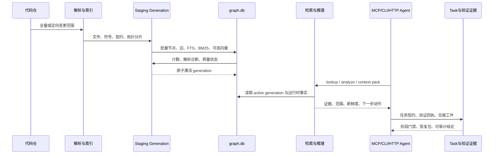
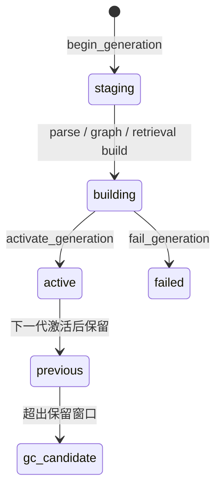
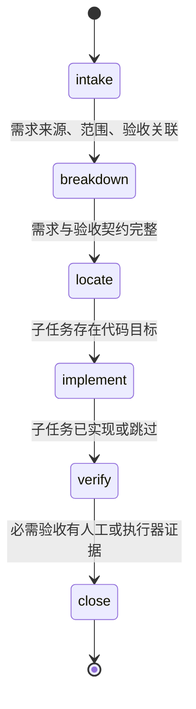

# Memory Center 产品与技术介绍

> 适用于技术面试、架构评审、客户交流、售前演示和内部技术分享。
>
> 本文描述当前 `4.3.24` 的真实能力与边界。它不是产品承诺书；性能指标须以目标工作区的本地基准为准。

## 1. 一句话介绍

Memory Center 是一个面向 AI 编程助手的本地优先项目记忆与代码知识图谱系统。它把多仓、多服务工程中的代码结构、接口契约、调用关系、配置、任务过程和验证证据转成可检索、可解释、可恢复的本地工程上下文，并通过 CLI、MCP、HTTP 和 Workbench 提供给人和 Agent 使用。

它解决的不是“再做一个聊天机器人”，而是让 AI 在复杂工程里不必每次从零阅读代码，也不会把猜测、空结果或未验证经验当成事实。

## 2. 要解决的真实问题

大型工程中的 AI 编程助手通常会遇到五类问题：

| 问题 | 常见后果 | Memory Center 的处理方式 |
|---|---|---|
| 上下文无法持续 | 每个新会话重复搜索、理解不一致 | Session、Task、Handoff、Resume 构成有界工作记忆 |
| 跨服务影响不透明 | 改 DTO、Feign、MQ、配置时漏改调用方 | 静态索引把服务、接口、消息和配置关系写入图谱 |
| 检索不可信 | “没找到”被误读为“没有” | `knowledge_state` 明确 FOUND、NOT_FOUND、UNKNOWN、STALE 等状态 |
| Agent 行为不可审查 | 无法说明为什么改、是否验证过 | Evidence、Ref、Validation、GateResult、审计事件形成证据链 |
| 经验会污染 | 模型自评成功后把错误做法固化 | Skill 必须经过候选、灰度、证据观测、发布或回滚 |

## 3. 核心思想

### 3.1 本地优先

源码、索引、图谱、任务工件和审计默认落在工作区 `.memory-center/`。系统不要求把业务代码或原始对话上传到中心服务，适合内网、私有仓库和受控研发环境。

### 3.2 图谱优先，而不是只做关键词搜索

系统把 `Service`、`File`、`Class`、`Method`、`Endpoint`、`FeignClient`、`MQTopic`、`ConfigKey` 等实体及关系写入 SQLite 图谱。检索既可以按文本召回，也可以沿调用、契约、配置和消息关系展开。

### 3.3 证据优先，而不是模型自信优先

回答和结论显式区分 `EXTRACTED`、`INFERRED`、`AMBIGUOUS`、`VERIFIED`。空结果只表示当前范围未发现或证据不足，不能自动推导为“工程中不存在”。

### 3.4 面向 Agent 的任务级接口

MCP 不暴露几十个底层原子能力，而是聚合为 `mc_start`、`mc_lookup`、`mc_analyze`、`mc_sync`、`mc_resume`、`mc_handoff`、`mc_close` 与 `mc_admin` 等任务级入口，降低工具选择和上下文消耗。

### 3.5 可验证的经验演进

经验不是自动写进知识库。已验证交付先形成候选 Skill，再进入 `canary`；只有至少三条带证据引用的成功观测且没有失败，才允许显式发布。发现回归可以立即回滚，历史证据仍保留。

## 4. 系统全景


### 分层职责

| 层 | 关键能力 | 价值 |
|---|---|---|
| Workspace | 多项目配置、服务识别、规则与宿主绑定 | 统一工作范围 |
| Indexing | Java/Spring 解析、多语言结构索引、局部重建 | 提取工程事实 |
| Graph & Storage | SQLite 图、断言、运行记录、版本 generation | 可重建的本地事实库 |
| Retrieval | 精确匹配、图邻居、BM25、可选语义与向量召回 | 准确且有边界的定位 |
| Orchestration | 上下文、影响分析、恢复、交接、交付门禁 | 把能力变成任务流程 |
| Governance | 证据等级、错误模型、审计、性能门禁、发布门禁 | 可解释、可审计、可回滚 |
| Adapters | CLI、MCP、HTTP、Workbench、Hooks | 适配不同使用方式 |

## 5. 关键技术与实现选择

### 5.1 为什么使用 SQLite 图谱

- 本地部署零额外基础设施，适合每个工作区独立使用。
- 图结构、全文检索、运行时记录和治理侧车可以统一在一个可备份、可迁移的本地事实库中。
- 静态断言从图边按需派生，避免复制大量边到多份 JSONL/SQLite 表。

### 5.2 为什么采用混合检索

- 精确图查询适合符号、接口、消息、配置等确定性问题。
- BM25 对类名、方法名、配置键、技术术语稳定可靠。
- 可选语义检索弥补自然语言表达差异。
- 排序不会让语义召回覆盖精确事实；缺少模型或向量能力时会明确降级，而不是隐式下载或重建。

### 5.3 为什么索引采用 generation 与定向刷新

- 重建先在 staging generation 完成，成功后才原子激活，避免半成品索引被查询到。
- 代码发生变化时优先定位受影响项目和路径，不把全量扫描放进查询热路径。
- 查询返回 generation、新鲜度和范围，调用方知道结论基于哪一版索引。

### 5.4 为什么影响分析允许部分成功

`mc_analyze` 先计算图谱影响，再补充计划、规则、契约和验证清单。后续辅助阶段暂时不可用时，系统保留已经成功的影响证据，返回 `analysis_status="partial"`、安全诊断和下一步动作，而不是用笼统内部异常覆盖全部结果。

### 5.5 为什么经验演进不训练模型权重

Memory Center 的定位是外置、可审计、可回滚的工程经验系统，不是训练平台。它不对用户模型做强化学习或无约束自博弈，避免成本、隐私、数据分布和验证不可控的问题。

## 6. 用户可感知能力

### 日常定位

开发者或 Agent 可以查符号、代码、调用方、被调用方、方法链路、接口契约和上下文包。对于长链路，可从方法体、Feign、Controller、Service Impl 继续展开，而不是只返回一堆文件名。

### 变更影响分析

修改重要 API、DTO、Feign、MQ、配置前调用 `mc_analyze`。它按 `quick`、`standard`、`full` 分层返回影响关系、变更计划、规则、契约检查和验证清单；高成本分析可进入后台任务。

### 长任务协作与恢复

通过 `mc_start -> mc_lookup -> mc_analyze -> mc_sync -> mc_close` 建立任务过程。会话中断或切换模型后，`mc_resume` 和 `mc_handoff` 返回有界恢复包，而不是重新读取整库。

### 新鲜度与持续索引

watcher 可以对源码和配置变更做去抖、定向刷新，生成轻量变化摘要。深度影响分析仍需显式触发，避免后台任务占用交互路径。

### 质量与治理

系统提供 parser 对比、Golden Benchmark、Java 调用解析门禁、检索回放、Token 与延迟趋势、发布门禁。真实工作区缺少样本时会明确标记为缺失，不用示例数据伪装成真实效果。

## 7. 安全、隐私与边界

- 默认不上传源码、原始对话正文、工具载荷或私有验证日志。
- MCP 审计保存脱敏摘要，默认保留一个月且最多十万条。
- 错误响应不会暴露绝对路径、密钥、堆栈或原始异常正文；可通过安全的 trace ID 关联本地审计。
- 验证执行器只运行 workspace 维护者预注册的 argv profile，不执行模型输出或需求正文中的任意 shell 字符串。
- 生成的文档、案例、Skill 和导出物都应只引用证据，不复制私有源码正文。

## 8. 性能设计原则

1. 查询热路径只读取已发布 generation，不隐式重建索引或下载模型。
2. 采用有限深度、有限边数、有限候选数和紧凑输出预算，防止大图遍历失控。
3. 局部刷新、向量维护、社区分析、失败归纳和多轨迹归纳均是显式或后台工作，不阻塞普通 MCP 查询。
4. 任何优化以真实工作区的 P50/P95、召回、误命中、Token 和验证结果为准，不以宣传指标替代基准。

## 9. 三种讲法

### 面向客户

“它把企业现有代码仓变成 AI 可安全使用的本地工程知识底座。AI 不再只靠临时搜索，而是基于服务调用、接口、消息、配置和验证证据工作。系统保留在客户环境内，支持追溯、灰度和回滚。”

### 面向技术面试

“这是一个把 RAG、代码图谱、任务记忆和治理闭环结合的本地 Agent 基础设施。难点不在于一次检索，而在于索引新鲜度、事实与推断边界、跨入口一致性、性能热路径和错误经验不污染知识库。”

### 面向内部技术分享

“我们把 Agent 的工程上下文拆成可重建事实、可审查任务工件和可验证经验三层。对所有自动化结论强制附带范围、generation、证据等级和下一步动作，避免‘模型说已经理解了’成为唯一依据。”

## 10. 五分钟演示脚本

1. 展示 `memory-center status`：确认 workspace、索引 generation、解析器、新鲜度和运行状态。
2. 用 `mc_lookup(mode="auto")` 或 CLI `symbol` 定位一个接口、DTO 或服务。
3. 调用 `mc_analyze(depth="standard")`：展示影响边、规则、计划和候选验证路径。
4. 修改一个受控示例或展示 watcher 产生的变更摘要，说明为什么不会自动进行昂贵全链路分析。
5. 展示 `mc_start / mc_resume / mc_handoff`：说明长任务和多 Agent 如何接续。
6. 展示 delivery Skill 的 `candidate -> canary -> published|rolled_back`：强调经验发布需要客观验证。

演示时只使用公开示例或客户授权的脱敏工作区，不展示私有路径、源码正文、账号、密钥和真实业务数据。

## 11. 常见问题

**它是否替代 IDE、代码搜索或代码评审？**

不替代。它为 Agent 和开发者提供结构化上下文、影响面和证据链；逐行阅读、设计决策和代码评审仍由人和现有研发流程负责。

**它是否保证分析结论绝对正确？**

不保证。系统通过 evidence level、confidence、knowledge state、验证清单和真实基准降低误判，并明确哪些结论仍需要人工验证。

**是否依赖外部向量数据库或云端模型？**

不依赖。默认可在本地运行；可选启用本地语义模型与 ANN 索引，但它们不改变本地优先和显式降级原则。

**最适合什么场景？**

多模块 Java/Spring Cloud 工程是当前最成熟场景；系统也支持多语言结构索引。需要跨服务变更、长任务协作、私有部署或高审计要求的团队收益最大。

## 12. 当前限制与下一步

- Java/Spring 的结构与契约提取最成熟；其他语言以通用结构索引为主。
- 调用图是静态分析结果，反射、动态代理、运行期拼接等场景需要结合运行时证据验证。
- 真实质量与性能基线需要随目标工作区和真实 replay 持续积累。
- 当前最高优先级是继续提升真实 Java 调用解析精度与未解析调用分类，而不是无边界增加功能。

## 13. 延伸阅读

- [项目总览](../README.md)
- [系统架构](ARCHITECTURE.md)
- [使用指南](USER_GUIDE.md)
- [MCP 接入指南](MCP_GUIDE.md)
- [接口参考](REFERENCE.md)
- [本体与语义边界](ONTOLOGY.md)
- [当前演进计划](NEXT_PHASE_MASTER_PLAN.md)

---

# 技术深讲：架构面试与技术分享材料

> 本部分用于 30 至 60 分钟的技术面试、架构评审或内部分享。它描述的是已实现的设计与约束，不把规划中的能力表述为现状。

## 14. 用一句技术语言重新定义系统

Memory Center 不是“给代码库加一个向量库”，而是一个以 **可重建静态事实图谱** 为底座、以 **有界混合检索** 为读取路径、以 **任务本体和验证证据** 为控制面的本地 Agent 工程上下文系统。

可以用下面的分层公式解释：

```text
可信工程上下文
= 已发布 generation 的代码事实
+ 有界图推理与多源召回
+ 任务范围与验证证据
- 未经验证的模型推断
```

这里有四个关键边界：

1. **事实与推断分开**：解析器、图边、索引记录是事实候选；风险模式和多跳链路是推断；只有显式验证才能成为 VERIFIED。
2. **索引与查询分开**：重解析、向量构建、社区分析、失败聚类不进入普通查询热路径。
3. **控制面与数据面分开**：generation、staging、刷新任务、策略和门禁管理数据何时可见；图谱、倒排和向量索引回答查询。
4. **经验与事实分开**：Skill 只是一套可回滚的操作建议，不会反向改写代码事实或自动提升证据等级。

## 15. 端到端数据流



### 15.1 索引数据流

一次 reindex 不是简单的“遍历文件后写 JSON”。它的流水线为：

```text
workspace.yaml
  -> 服务与路径范围解析
  -> 文件扫描和忽略规则
  -> 语言解析（Java 优先 tree-sitter，失败或缺依赖时 regex fallback）
  -> Spring 语义提取（Endpoint / Feign / MQ / Config / DataResource）
  -> Java 调用解析（CALLS_METHOD + confidence）
  -> 图节点与图边批量写入
  -> FTS5 / BM25F / sparse semantic / optional dense vector 同步
  -> generation 分片与 manifest
  -> 质量计数、诊断和原子激活
```

索引输出同时存在三种形态：

| 形态 | 用途 | 是否热路径事实源 |
|---|---|---|
| `graph.db` 中的图、运行时和检索表 | 查询、分析、审计聚合 | 是 |
| `index/*.json` | 审查、导出、诊断 | 否 |
| generation 分片与 manifest | 定向查询、回滚、发布控制 | 是 |

这避免了“JSON 是运行时后备、SQLite 又是另一份真相”造成的双写漂移。文件导出可读，但运行时读取以 SQLite 事实库和已发布 generation 为准。

### 15.2 查询数据流

```text
用户意图
  -> 查询规划（fast / standard / deep + intent）
  -> freshness 与 shard route 判断
  -> 精确实体 / 图邻居 / FTS / BM25F / sparse / optional ANN 候选
  -> RRF 融合 + 类型加权 + 图关系排序
  -> 有界证据扩展和推理管线
  -> knowledge_state + evidence_level + diagnostics + next_action
```

查询不是“每次重新理解仓库”。它只消费已经发布的数据，最多在任务入口针对命中目标执行定向 refresh；没有任何路径会因为普通 `mc_lookup` 自动触发全量 reindex、全图扫描或模型下载。

## 16. 代码事实图谱：Schema、关系与置信度

### 16.1 实体建模

图谱主要由以下实体组成：

| 实体域 | 核心实体 | 解决的问题 |
|---|---|---|
| 代码结构 | `Service`、`File`、`Class`、`Method`、`Field`、`Module`、`Function` | 文件和符号定位 |
| 接口契约 | `Endpoint`、`FeignClient`、`FeignMethod`、DTO 相关边 | API 和服务间契约影响 |
| 异步与配置 | `MQTopic`、`MQConsumer`、`MQProducer`、`ConfigKey`、`DataResource` | 隐式依赖与运行配置风险 |
| 工作过程 | `Session`、`Task`、`Ref`、`Receipt`、`Validation`、`GateResult` | 会话恢复与验证闭环 |
| 治理与本体 | `Decision`、`Policy`、`Constraint`、`Action`、`Assertion` | 结论、规则和行动的可追溯性 |

实体 ID 以稳定语义键构造，而不是依赖数据库自增主键。例如，代码目标通常由项目、逻辑路径、符号名或签名组成；这样在 generation 切换、JSON 导出和跨入口返回中都能引用同一个对象。

### 16.2 边语义

边不是单纯的“相关”。常见边包括：

```text
Service --CONTAINS--> File --DECLARES--> Class --DECLARES--> Method
Controller --EXPOSES_ENDPOINT--> Endpoint
FeignClient --IMPLEMENTS_FEIGN--> FeignMethod --CALLS_SERVICE--> Service
Producer --PRODUCES_TOPIC--> MQTopic --CONSUMES_TOPIC--> Consumer
Method --CALLS_METHOD--> Method
Method --READS_CONFIG--> ConfigKey
Method --USES_DATA_RESOURCE--> DataResource
```

治理关系使用另一组显式语义：`AFFECTS`、`EXPLAINS`、`VERIFIES`、`REJECTS`、`VALIDATES`、`GOVERNS`、`VIOLATES`、`WAIVES`、`APPROVES`、`SUMMARIZES`。关系端点由统一 registry 校验，避免出现“任意字符串都可以连边”的伪图谱。

### 16.3 Java 调用解析为什么要带置信度

静态调用解析在 Java 中天然存在歧义。Memory Center 不把无法证明的 receiver 随机绑定到同名方法，而是保存解析层级：

| 解析层级 | 置信度 | 示例 |
|---|---:|---|
| `same_class` | 1.00 | 同类、`this`、`super`、裸方法调用 |
| `same_package` | 0.90 | 同 package 类型匹配 |
| `import` / `static_import` | 0.85 | 显式 import 匹配 |
| `wildcard_import` | 0.60 | 通配 import 匹配 |
| `unresolved` | 0.30 | 只保留调用证据，不绑定随机目标 |

高置信调用边优先参与 caller/callee 和影响分析；只有没有高置信结果时才展示低置信回退。这是比“尽量画满调用图”更重要的工程选择，因为错误边会在多跳分析中指数放大。

### 16.4 双时间与断言

对结论对象，系统区分：

- `event_at`：源代码修改、人工验证或治理事件实际发生的时间；静态事实优先来自源码修改时间。
- `observed_at`：Memory Center 看到、解析或记录该对象的时间。
- `valid_from` / `valid_to`：结论在业务或治理上有效的时间窗口。

因此“某接口在上周是否存在”“索引何时发现它”“某项豁免何时失效”不是一个问题。历史查询可选择有效期、事件时间或观测时间，且单次结果受上限约束。

## 17. 检索算法：不是单模型排序

### 17.1 查询规划先于召回

系统先按意图选择检索源，而不是把所有引擎同时跑一遍：

| 意图 | 硬约束 | 可选召回 | 典型原因 |
|---|---|---|---|
| 符号、Endpoint、Feign、MQ、配置 | exact graph | FTS、BM25 | 实体精确性优先 |
| caller/callee、链路、walkthrough | exact + graph | BM25、sparse | 必须有可解释的边 |
| 自然语言定位 | BM25、sparse | graph、vector | 需要补足表达差异 |
| 全链路方法分析 | 指定方法 + 图续链 | 有界补充 | 不能退化为仓库全扫 |

策略还会结合索引新鲜度、当前 request tier、已验证的工作区校准快照和候选预算。被禁用或不可用的检索源会写入 diagnostics，而不是把“后端没启动”伪装成“没有结果”。

### 17.2 融合与排序

候选合并采用 Reciprocal Rank Fusion（RRF）作为稳定基线：

```text
score(d) = Σ source_weight(s) / (k + rank_s(d))
```

RRF 的优势是不同检索源的分数尺度无需强行归一化：图查询、BM25、稀疏语义和 ANN 的原始分数不具有可比性，但它们的相对排名可融合。融合后还会施加：

1. **类型加权**：查询 Feign 时提高 `FeignClient`、`FeignMethod`、`Endpoint` 的优先级。
2. **关系加权图排序**：在固定候选集合上做 relation-weighted personalized ranking，而不是对全图做无界传播。
3. **证据预算**：只对 top-N 候选展开有限深度邻居和摘要，防止高扇出节点耗尽 token。
4. **可选 Cross-Encoder 重排**：只重排前 12 个候选，且模型必须已预热；查询过程不等待模型下载或加载锁。

### 17.3 BM25F 与稀疏语义

SQLite 倒排索引使用代码感知 BM25F。实体名称、接口路径、契约字段、文件路径和元数据进入不同字段并使用不同权重，而不是把所有文本拼成一段长字符串。这样 `publishArticle`、`/article/publish`、`ArticlePublishRequest` 和配置键的匹配不会互相淹没。

稀疏语义是默认能力，dense embedding 是显式可选能力。原因不是否定向量，而是代码库中的符号、路径、API 和配置键具有强字面信号，默认先保留高精度、低依赖的召回路径。

### 17.4 Dense Vector 与 ANN

设置 `MEMORY_CENTER_SEMANTIC_BACKEND=sentence-transformers` 后，系统可以为 selective 或 all 范围的候选生成 dense vector。向量检索后端优先级为：

```text
sqlite-vec -> hnswlib HNSW -> 仅 <= 64 向量的精确校验 -> 可诊断 unavailable
```

关键设计不是“有 embedding 就能查”，而是：

- 大索引未安装 ANN 时禁止 Python 暴力余弦回退，避免一次查询耗尽解释器并拖慢 MCP。
- HNSW 的向量事实、label 映射和索引文件在同一锁内维护；索引文件通过临时文件原子替换。
- 查询获取 ANN 锁的等待预算为 300ms；维护期间返回可重试 diagnostics，而不是阻塞会话。
- 模型维度写入后端元数据；模型切换导致维度不一致时拒绝复用旧索引，要求显式完整 reindex。
- HNSW 使用有界 self-recall 探针调节 `ef_search`，在延迟和召回之间取得可观测平衡。

这部分是技术面试中可重点展开的取舍：**向量质量、索引一致性、依赖可用性和查询尾延迟必须一起设计。**

### 17.5 权重学习的约束

融合权重不会根据“Agent 是否采纳了推荐”自动调整。采纳可能只是模型习惯、用户偏好或工具可用性，并不代表检索正确。系统只读取带证据的人工验证 replay，以平滑后验和样本收缩生成候选校准，再由显式 `--apply` 写入工作区。这个设计把学习限定为“建议优化”，而非让不可验证行为污染事实排序。

## 18. 索引新鲜度、generation 与局部刷新

### 18.1 为什么不能直接覆盖索引

如果全量重建直接写当前索引，查询可能看到半张图：新 Controller 已写入，但 Feign、BM25 或向量还没完成。这会导致结果看似成功、实际缺边，是最难诊断的错误之一。

Memory Center 使用 generation 控制面：



- 重建先写 staging generation。
- 成功完成后才原子切换 active generation。
- 局部刷新可以 copy-on-write 复用未受影响分片，只重建受影响服务或路径。
- 查询只读 active generation；分片未发布时显式返回 `NOT_INDEXED`，不会悄悄扩大到过期的全局结果。
- generation GC 默认保留当前与上一代，删除必须显式确认。

### 18.2 watcher 与热路径隔离

watcher 在独立进程中轮询并去抖源码、配置变更，生成有界 partial reindex job。它的职责是让“相关代码尽量自动变新”，但不会把全量扫描塞进 Agent 对话：

```text
源码变更 -> debounce -> 失效范围 -> partial reindex -> activate generation
                                      -> 轻量 change report
                                      -> 高风险时建议显式 mc_analyze(full)
```

因此自动化只负责保持事实新鲜，不负责把高成本、低确定性的深度分析偷偷执行掉。

## 19. 任务、会话和交付：把 Agent 行为变成可控制流程

### 19.1 四层记忆

| 层 | 内容 | 典型载体 | 生命周期 |
|---|---|---|---|
| L0 | 原始会话和工具事件摘要 | JSONL + payload ref | 短期、可裁剪 |
| L1 | 已验证经验原子 | Case / Receipt | 可复用、需证据 |
| L2 | 当前任务上下文 | context、design、plan、summary | 任务级 |
| L3 | 稳定工作区规则 | profile、team rules、architecture invariants | 跨任务 |

长任务恢复不是把历史对话全文重新塞给模型，而是读取当前任务摘要、未决项、最近证据、验证状态和下一步动作。这样可以将 token 成本与任务复杂度绑定，而不是与历史对话长度绑定。

### 19.2 交付状态机



任务子项可声明 `read_targets`、`write_targets`、`stop_conditions`。默认系统把它们作为透明范围契约；工作区开启 `enforce_scope_contract` 后，范围不完整的子任务不能进入实现阶段。这把“Agent 应该小心”转化为可检查、可审计的状态条件。

### 19.3 验证执行器为什么只接受 argv profile

模型输出的 shell 命令是非可信输入。交付执行器只允许工作区维护者在 policy 中注册参数数组，例如：

```json
{
  "validation_profiles": [
    {
      "id": "unit-test",
      "argv": ["mvn", "test", "-pl", "service-a"],
      "timeout_sec": 900
    }
  ]
}
```

执行时记录退出码、受限输出摘要、哈希和验收关联。随手传入的命令只会作为脱敏记录，不会被执行。这个约束同时降低命令注入风险、避免错误复现成本，并让关闭门禁具备可审计语义。

### 19.4 Skill 演进闭环

```text
已关闭且验证完整任务
  -> candidate
  -> canary（隔离，不进入默认检索）
  -> 至少 3 条带证据的 passed 且无 failed
  -> published
  -> 发现回归则 rolled_back
```

Skill 不是训练权重，也不直接改变检索事实。它只保存脱敏的结构信息、稳定 ID、适用条件、验证证据和生命周期，因而可回滚、可比较、可审计。

## 20. 性能工程：如何保证“可用”而非“理论上可查”

### 20.1 热路径预算

热路径原则是：**每个高成本动作必须有边界、缓存、异步化或明确拒绝语义。**

| 风险 | 处理策略 |
|---|---|
| 大图多跳爆炸 | 跳数、边数、节点数、候选数和输出 token 全部受限 |
| 向量暴力扫描 | 大索引仅允许 sqlite-vec / HNSW；无 ANN 时显式 unavailable |
| 模型冷启动 | 只用已预热模型；预热中保留基础排序，不等待锁 |
| 全量重建影响查询 | staging generation + active 原子切换 |
| 文件变更导致全仓扫描 | watcher 去抖 + project/path scoped partial rebuild |
| SQLite 写读互相阻塞 | WAL、连接池、短事务、索引锁超时与后台维护 |
| 大型审计 JSONL 扫描 | 时间/条数保留窗口，超阈值物理压缩移到后台 |

SQLite 连接统一设置 WAL、`synchronous=NORMAL`、cache、`temp_store=MEMORY`、mmap 和 foreign keys；全量重建可以短时使用 fast write mode。这里的核心不是盲目调 PRAGMA，而是将其约束在可重建的索引写入路径，避免让业务工件写入失去可靠性。

### 20.2 可执行性能门禁

性能不是单个 benchmark 数字，而是发布前的多维预算：

- 默认查询 P95。
- 局部 refresh 的额外开销。
- 完整 reindex 的额外开销。
- parser fallback 率和 critical disagreement。
- Golden anchor / edge recall、forbidden hit。
- 历史查询返回上限和审计 SQL 聚合边界。
- 真实 workspace 的 benchmark/gate 摘要。

所有高成本真实工作区 benchmark 在临时索引目录中比较“图索引基线”和“含断言侧车”，不改写用户正式 generation；完整 reindex 性能测试必须显式启用。

### 20.3 可观测性

系统输出的不只是结果，也包含运行解释：

```text
generation / shard_route / freshness
retrieval_policy / retrieval_diagnostics
parser_diagnostics / parser_precision
analysis_status / diagnostics.trace_id
knowledge_state / scope_checked / next_action
```

这使得线上问题可以回答：到底是索引未覆盖、generation 未发布、向量后端不可用、解析器回退、查询策略过窄，还是事实确实不存在。

## 21. 可靠性与故障语义

### 21.1 空结果不是否定事实

所有核心查询使用统一 `knowledge_state`：

| 状态 | 含义 | Agent 应做什么 |
|---|---|---|
| `FOUND` | 当前范围有证据 | 继续读取证据并验证高风险结论 |
| `NOT_FOUND` | 当前已检查范围未发现 | 不得写成“系统不存在” |
| `UNKNOWN` | 证据不足或无法判断 | 缩小问题或补充证据 |
| `NOT_INDEXED` | 目标范围未被索引 | 局部刷新或显式 reindex |
| `STALE` | 索引可能落后源码 | 核对实时文件或刷新 |
| `REJECTED` | 结论被显式否定 | 不得继续作为推荐事实 |

每个状态都伴随 `absence_reason`、`scope_checked` 和 `next_action`。这相当于把分布式系统中的“部分可用、未知、未同步”语义带入代码知识检索，避免负向结论被过度解读。

### 21.2 部分成功语义

`mc_analyze` 将图谱 impact 视为主结果，计划、规则、契约、检查清单等视为可降级增强。图谱已成功时，增强阶段失败返回：

```json
{
  "analysis_status": "partial",
  "diagnostics": {"trace_id": "..."},
  "next_action": "基于已返回的影响证据继续验证，或重试不可用阶段"
}
```

只有入口本身或主影响图失败时才返回统一错误。这样的设计避免了“一个非关键模块异常，全部影响分析变成 Internal Error”的产品灾难。

### 21.3 并发与写入一致性

- reindex 使用 workspace lock 串行化。
- 运行时 SQLite 通过统一连接池和事务访问。
- HNSW 维护使用独立文件锁，查询锁有短超时。
- generation 通过 staging/activate 控制可见性。
- 核心任务工件默认追加式写入，并记录 write receipt 与审计引用。

这套策略牺牲了少量并行写吞吐，换取本地单工作区场景下更易理解、更容易恢复的一致性模型。

## 22. 安全模型与数据最小化

### 22.1 信任边界


系统默认不将源码、原始 prompt、请求体、响应体、密钥或完整验证日志发送到外部服务。审计只保留工具名、脱敏参数摘要、耗时、状态、规模以及可选 task/session 关联；默认保留一个月，最多十万条。

### 22.2 为什么“本地优先”不是简单地把数据放到磁盘

本地优先还意味着：

- 外部 embedding 模型不可用时必须返回可诊断降级，而不是静默改为云调用。
- 示例、基准和导出不含真实私有路径、服务名、密钥和索引产物。
- 运行时和治理断言保存证据引用及受限摘要，不把私有正文复制到多个 sidecar。
- 删除、generation GC、断言稀疏化和迁移都是显式维护动作，默认不隐式清理历史。

## 23. 面试讲法：从浅到深的 15 分钟结构

### 23.1 前两分钟：问题与定位

> “复杂工程里的 Agent 不是缺少大模型能力，而是缺少可持续、可信、低延迟的工程上下文。Memory Center 把代码解析成可重建图谱，把检索限制在已发布索引，把任务过程收敛为证据和门禁，因此它既是 RAG 基础设施，也是 Agent 的工程控制面。”

### 23.2 第三到第六分钟：核心架构

讲四层：

1. 索引层负责把源码变成确定性事实。
2. `graph.db`、BM25 和 ANN 负责本地读取。
3. 编排层负责 context pack、影响分析、任务恢复和交付状态机。
4. MCP/CLI/HTTP/Workbench 只做适配，不能复制领域语义。

强调关键不变量：查询只读 active generation；空结果不等于不存在；Skill 不等于事实；模型命令不等于可执行命令。

### 23.3 第七到第十分钟：最难的三个技术问题

**问题一：静态代码图如何避免“边越多越不准”？**

回答：Java 调用边保存解析来源和置信度，默认优先高置信边；无法解析时保留 unresolved 证据而非猜测。影响分析宁可报告 AMBIGUOUS，也不能制造错误依赖。

**问题二：语义检索如何在大索引下保持 P95？**

回答：查询规划控制检索源；精确图和 BM25 优先；dense 只对 selective candidates 建索引；大索引必须走 sqlite-vec 或 HNSW，禁止 Python 暴力余弦扫描；ANN 锁超过 300ms 就降级为可诊断状态。

**问题三：索引实时更新如何不拖慢 Agent？**

回答：watcher 在后台去抖并做 scoped partial reindex；generation staging 完成后原子激活；查询读 active generation，不会等待全量扫描或看到半成品。

### 23.4 第十一到第十五分钟：可控 Agent 与质量闭环

讲任务状态机、argv 验证执行器、`knowledge_state`、`partial` 分析结果和 Skill canary。最后落到一句：

> “我们没有相信 Agent 的自我描述，而是让它的每个高风险结论、修改范围和经验发布都有证据、状态和可回滚路径。”

## 24. 高频追问与技术回答

**为什么不是 Neo4j、Milvus、Kafka 一套分布式架构？**

目标部署单位是一个本地 workspace，不是中心化在线图服务。SQLite 将图、FTS、运行记录、倒排和向量元数据放入单个可备份事实库，运维成本和数据出域风险更低。若未来需要多租户共享服务，可将当前事实模型和 generation 协议迁移为服务端控制面，但不能先用基础设施复杂度替代产品价值。

**为什么不只用 ripgrep 和 LLM？**

`rg` 擅长实时文本定位，但无法稳定表达 Feign 到服务端、MQ 生产消费、配置引用、方法调用置信度和任务验证状态。Memory Center 不替代 live read；当索引 stale 时会主动建议读取实时文件。它补的是跨文件、跨服务、跨会话的结构化关系与审计。

**为什么不用纯向量 RAG？**

代码中的符号、路径、API、配置键和调用方向是强结构信号。纯向量容易召回语义相似但契约无关的代码，且难以解释。系统以 graph/exact 作为结构约束，以 BM25F 提供字面稳定性，以 ANN 补自然语言表达差异。

**如何评估准确率？**

针对不同层分别测：parser differential 与 Java call resolution 测抽取正确性；Golden anchor/edge recall 与 forbidden hit 测检索；真实 replay 测任务建议是否被验证；P50/P95、token、partial refresh 成本测性能。不能用“模型觉得回答不错”作为唯一指标。

**为什么只允许预注册验证命令？**

因为模型生成的命令属于不可信输入。允许任意 shell 会把提示注入、误删、环境污染和不可复现都带进交付闭环。argv profile 提供可审查 allowlist，也能把命令、超时、退出码和验收标准关联起来。

**系统如何处理索引过期？**

不假装最新。响应携带 freshness、generation 和 scope；watcher 尝试局部刷新；高风险目标要求实时文件核对或显式 reindex。结论会显示为 `STALE`、`NOT_INDEXED` 或 `UNKNOWN`，而不是生成一个肯定句。

**最大的技术债或下一步是什么？**

持续用真实 workspace replay 校准检索权重和 ANN 参数；继续提升 Java 动态调用、反射和框架代理场景的可解释分类；并保持任何新增能力不进入默认查询热路径、不破坏证据边界。

## 25. 对外分享的建议材料组合

| 时长 | 推荐内容 | 不建议展开 |
|---:|---|---|
| 5 分钟 | 问题、架构全景、图谱 + evidence、一个 impact demo | 具体表结构和算法参数 |
| 15 分钟 | 加 generation、混合检索、任务状态机、性能边界 | 所有 CLI 参数 |
| 30 分钟 | 加 Java call resolution、ANN、质量门禁、故障语义 | 私有真实 workspace 细节 |
| 60 分钟 | 加 schema、演进取舍、benchmark、现场 demo 和 Q&A | 未验证的路线图承诺 |

分享时建议把 [系统架构](ARCHITECTURE.md) 作为实现依据，把 [接口参考](REFERENCE.md) 作为操作附录，把本文作为叙事主线。所有真实效果都应展示对应 workspace 的 generation、parser 状态、检索诊断和 benchmark 结果，而不是展示脱离环境的单一截图。
