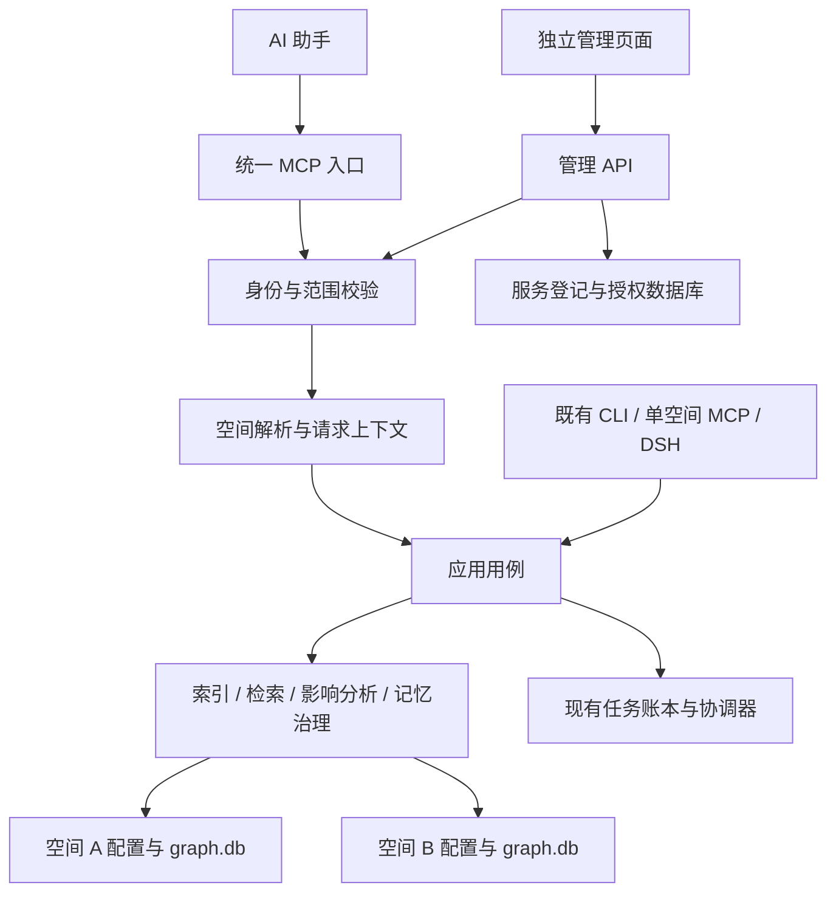

# Memory Center 服务化与管理系统技术方案

> 类型：决策与开发方案（decision）。日期：2026-10-09。
> 基线：4.6.30，提交 `a97f384`；版本保留分支 `codex/release-4.6.30`，后续开发分支 `codex/service-platform`。
> 状态：产品方向已确认；本文件描述目标设计，服务入口、管理页面及新增接口尚未实现。
> 本方案遵守现有核心依赖方向和证据治理约束；公开接口事实仍以代码、schema 和当前操作文档为准。

## 1. 产品目标与第一阶段范围

Memory Center 演进为面向 AI 助手的上下文与记忆服务：一次安装、常驻启动，通过独立管理页面登记多个项目，通过统一 MCP 入口提供代码理解、影响分析与工程记忆。后续扩展文档知识库、Wiki 和个人长期记忆。

用户流程：安装启动 → 打开管理页面 → 登记项目 → 预览识别出的仓库/服务 → 显式建立索引 → 配置 MCP 客户端 → 在各项目中使用。

第一阶段交付本机单用户服务。独立项目之间默认隔离，一个项目可以包含多个相关仓库/服务。团队身份、远程采集、文档解析、自动 Wiki 生成和个人记忆属于后续阶段，不列入首版验收。

第一阶段的核心验收：两个无关联项目、两个同时运行的 AI 会话，连接同一个服务，分别查询与记录自己的任务和记忆；管理页面能够查看索引进度；重启后登记信息和已发布索引保留。

## 2. 已核对的实现基线

| 能力 | 当前源码证据 | 可复用部分与缺口 |
|---|---|---|
| 核心分层 | [架构](ARCHITECTURE.md)、[ADR-0001](adr/0001-core-dependency-direction.md) | 入口调用应用用例，核心不依赖入口；服务化延续该方向 |
| 单空间 MCP | [server.py](../memory_center/mcp/server.py)、[runtime.py](../memory_center/mcp/runtime.py) | `create_server(workspace_file)` 在实例中固定 `WorkspaceContext`；`main` 接收 `--workspace` 后运行 SDK 默认传输；尚无本方案的多空间请求入口 |
| HTTP JSON API | [server.py](../memory_center/http/server.py)、[路由参数](../memory_center/http/routes/params.py) | `ThreadingHTTPServer`、默认 workspace、Bearer 校验、读写方法约束可参考；不是本方案的 ASGI/MCP 管理服务 |
| 多 workspace 登记 | [registry.py](../memory_center/core/governance/registry.py)、[CLI](../memory_center/cli/commands/workspaces.py) | 已有全局 `registry.json` 和 group；需稳定 ID、事务、授权与并发管理能力 |
| 项目配置与存储 | [config.py](../memory_center/core/workspace/config.py)、[workspace.py](../memory_center/core/storage/workspace.py) | 配置 root 支持相对配置文件定位；存储以配置所在目录为基准，具备外置配置的基础，但完整索引/Hook 路径仍需验证 |
| 后台任务 | [应用用例](../memory_center/application/jobs.py)、[workspace jobs](../memory_center/core/workspace/jobs.py)、[索引协调器](../memory_center/core/indexing/job_coordinator.py) | 已有进度、取消及索引冲突/合并/租约/发布治理；线程执行与全局资源预算需服务化梳理，不能重建第二套任务真源 |
| 索引与工程记忆 | [架构](ARCHITECTURE.md)、[MCP 指南](MCP_GUIDE.md) | 复用现有图、generation、分片、检索、任务与回执；不因服务化重写引擎 |
| Wiki 协作 | [wiki_bridge.py](../memory_center/core/knowledge/wiki_bridge.py) | 已有受治理的外部引用与哈希；不等于通用文档知识库或内置 Wiki 系统 |
| 页面边界 | [展示迁移](HTTP_DISPLAY_MIGRATION.md) | 4.6.30 的 `/ui/*`、`/app` 已下线，展示依赖 DSH；新管理页面是新的产品决策，不能把旧页面当作已可用能力 |

当前版本继续为 4.6.30，本轮不修改依赖、代码、MCP schema 或发行行为。

## 3. 领域与标识

首版界面的“项目”对应一个 workspace；不新增与 workspace 平行的项目事实库。现有 `project` 参数通常表示 workspace 内的服务分区，不得将它静默改成全局项目 ID。

| 标识 | 语义 |
|---|---|
| `workspace_id` | 服务登记时生成的稳定 ID，独立于名称与路径 |
| `display_name` | 可修改的界面名称，不作为授权锚点 |
| `source_roots` | 服务器能访问的源码根目录；首版可先从既有 workspace 配置推导 |
| `workspace_file` | 既有引擎执行所需的配置位置，只在服务内部解析 |
| `storage_mode` | 复用仓库内配置的 `external`，或服务数据目录中的 `managed` |
| `group_id` | 显式联合查询的空间集合；成员关系不授予访问权限 |
| `principal_id` | 调用主体，首版本地管理员与 MCP 令牌主体；不提前构造团队组织体系 |
| `session_id` / `task_id` / `ref_id` | 必须在对应 workspace 下解析，不能单凭字符串跨空间读取 |

登记状态采用 `active / paused / detached`；索引新鲜度、任务状态与登记状态分别展示。暂停拒绝新写入和新索引任务，可保留有界只读查询；移除接入撤销路由与令牌授权，不删除源码或数据。正在运行的任务需先排空或显式取消；数据清理是单独的受控动作。

## 4. 服务架构



新增服务编排层负责启动、认证、空间目录、资源预算、退出与就绪状态；应用层继续拥有跨领域用例。管理页面不读 SQLite、源码目录或任务工件，不复制检索、generation 或记忆生命周期逻辑。

候选目录边界（待实现）：

- `memory_center/service/`：服务生命周期、ASGI 装配、请求上下文、认证与空间解析。
- `memory_center/application/`：空间管理与现有能力组合的用例。
- `memory_center/core/`：目录/授权基础模型与已有引擎，保持 ADR-0001 的依赖方向。
- `frontend/`：独立管理页面源代码，构建产物通过明确的包资源策略分发。

技术基线保留 Python 和 SQLite。新增服务需要 ASGI 传输适配；先验证当前 MCP SDK 的 Streamable HTTP 挂载、生命周期与取消行为，再锁定 Web 框架和依赖范围。前端候选 Vue 3 + TypeScript + Vite；正式引入前验证构建与 Python wheel 打包，不在本轮添加依赖或锁文件。

首版由一个服务进程承载 API/MCP/静态页面，长时间索引通过有界 worker 执行。CPU 密集索引优先验证进程隔离；worker 创建自己的 Store/连接，不能跨线程或进程复用 SQLite 连接。扩展多实例前必须重新设计租约和共享存储，不能靠增加 HTTP worker 数量获得可靠性。

## 5. 存储布局与兼容迁移

目标服务数据目录由安装配置指定，默认候选 `~/.memory-center/service/`：

```text
service/
  service.yaml                 # 监听、预算、受管根目录等
  catalog.db                   # 空间登记、令牌哈希、授权、管理操作记录
  workspaces/
    <workspace_id>/
      workspace.yaml           # managed 空间配置，root 指向源码位置
      graph/graph.db           # 按现有 Store 布局保存空间事实
      rules/ memory/ artifacts/
```

`catalog.db` 只管理服务控制面，空间 `graph.db` 继续是索引、任务和工程记忆的运行时真源。跨项目查询联合授权后的结果，不把全部源码图混写进全局数据库。具体 managed 配置与路径规则必须由验证切片确认后固化。

既有 workspace 首版登记为 `external`：保存稳定 ID 与配置引用，原目录、图和工件不搬迁。新项目可走 `managed`，配置与数据放服务目录；管理操作不得隐式改写仓库 AGENTS 或安装 Hook。

旧 registry 导入流程：读取并预览 → 规范化真实路径与重复检查 → 事务写入稳定 ID → 验证逐项可读取 → 输出迁移回执。保留旧文件作为原始输入；失败不覆盖它，也不产生第二个可并行更新的登记真源。旧 CLI registry 操作在服务模式下须委托统一应用用例；独立模式兼容策略在切片 S1 中实现并测试。

仓库移动只更新映射并重新验证源码身份；分支切换不能混用旧索引，须报告提交/代际不匹配。备份必须采用一致性快照，覆盖控制面和各空间事实库，不能只复制正在写入的 SQLite 主文件而忽略 WAL。

## 6. MCP 路由与请求隔离

服务模式优先 Streamable HTTP；保留现有 `memory-center-mcp --workspace ...` 单空间 stdio 用法。仅支持 stdio 的客户端后续可通过薄代理连接同一服务；代理可以传递本机 cwd，不能在代理内再建索引与记忆引擎。

客户端的本地 cwd 不会自动到达远端 MCP 服务。统一接入必须有明确的解析合同：显式 `workspace_id`、session 已绑定空间，或本机代理提供且经过服务器登记校验的目录提示。MCP roots 仅为提示，不是授权证据。

路由规则：

1. 校验调用主体与可访问空间。
2. 显式空间与 session 绑定必须一致，冲突直接返回结构化错误。
3. 已绑定 session 固定其 workspace，不受其他连接的选择影响。
4. 无 session 时，目录匹配须在授权空间中唯一；多个候选返回选择提示，无匹配返回登记提示。
5. 不能从模糊意图、上一请求或“第一个项目”猜测写入目标。

每次调用构造不可变请求上下文：`principal_id / workspace_id / workspace_file / session_id / trace_id`。禁止在共享服务实例上更改 `ctx.workspace_file` 来切换项目。审计、连接、模型缓存、查询缓存、ref、取消令牌和资源锁需要逐项核查空间键；缓存至少区分空间、generation 与实际授权范围。

现有 MCP 工具保持兼容；新增空间选择/发现工具及可选 `workspace_id` 的具体 schema 在实现切片中确定。旧参数 `project`、`scope` 与工具返回语义不被重定义。服务模式缺少空间时给出操作指引；旧单空间模式仍使用启动绑定。

group 查询仅覆盖显式选择且已授权的成员，逐项保留来源 workspace、generation、coverage 与证据等级。首版跨空间操作只读，不做跨库事务性记忆写入。

## 7. 管理页面与 API 边界

| 页面 | 首版内容 |
|---|---|
| 概览 | 服务就绪、已接入空间、索引健康、正在运行与失败任务 |
| 项目列表 | 添加、编辑名称、暂停、恢复、移除接入；空态可直接开始登记 |
| 添加项目 | 服务端路径或已有配置 → 只读识别预览 → 确认登记 → 显式启动首次索引 |
| 项目详情 | 仓库/服务、索引覆盖率、generation、规则与有界记忆摘要 |
| 索引任务 | 按空间查看进度、阶段、冲突、失败原因、取消与重试 |
| MCP 接入 | 生成连接配置，创建、撤销、轮换令牌，选择可访问空间与读写权限 |
| 设置 | 服务数据目录、模型状态、并发与预算、备份状态 |

API 草案（尚未注册，不可作为当前可运行接口）：

- `/api/v1/service/status`：服务状态。
- `/api/v1/workspaces`：登记与列表；单项资源以稳定 ID 路由。
- `/api/v1/workspaces/preview`：有界识别，不建索引、不改仓库。
- `/api/v1/workspaces/{id}/jobs`：提交与查看；取消/重试走明确写入动作。
- `/api/v1/mcp-credentials`：授权配置与令牌生命周期。
- `/mcp`：MCP 传输入口；管理操作默认不暴露给普通 AI 令牌。
- `/admin`：新管理页面候选路径，与旧 `/ui/*`、`/app` 明确区分。

API 返回有界摘要；分页、预算、错误码、重复请求幂等键和返回投影在 S2 固化。记忆细节与来源按授权逐步展开。页面表单可以展示本机管理员正在配置的路径，但客户端生成配置、默认日志和普通 AI 返回只用稳定 ID。

默认监听 loopback。管理浏览器与 MCP 使用不同凭据；浏览器凭据通过受控初始化交换为会话，不把管理密钥打进静态文件或明文 URL。浏览器写入需同源、Origin/CSRF 校验；非本机部署增加 TLS 和明确身份配置。

登记源码目录仅向管理主体开放：规范化真实路径、校验存在与访问能力、处理软链接和父子目录歧义；读取和扫描范围由管理员配置的根目录约束。MCP 调用不得自行登记任意路径、扩大授权或触发全量重建。

## 8. 后台任务与资源治理

复用 `workspace_jobs` 与索引协调器的准入、指纹、租约、终态、重试 lineage、原子发布与取消规则；全局任务列表是这些账本的有界聚合投影，不是第二套状态机。

服务层新增全局索引并发上限、每空间冲突限制、模型调用预算和 worker 生命周期。关闭服务先拒绝新任务，允许限时排空，再将未完成任务保留为可诊断状态。重启恢复须区分运行中的有效租约与已失效 worker；首版不宣称所有任务可从中途自动续跑。

暂停/移除项目、取消任务与 generation 发布的竞态需要明确锁顺序。索引失败保留此前 active generation；清理、全量重建、模型切换和数据删除仍走显式动作与现有治理。

## 9. 开发切片与验收

| 切片 | 内容与依赖 | 必须通过的验收 |
|---|---|---|
| S0：服务骨架验证 | SDK/ASGI 传输、生命周期、静态资源与 wheel 打包验证；设计隔离合同 | 安装产物可启动、就绪与退出；无项目也可打开空态；不改变旧 stdio schema |
| S1：空间目录 | 稳定 ID、catalog、已有 registry 导入、external/managed 路径验证 | 两空间登记、改名不换 ID、重复路径/目录重叠可解释、重启保留；原 workspace 不改写 |
| S2：请求隔离 | 授权与不可变上下文、session/ref/cache 作用域、管理 API | 并发 A/B 查询写入不串空间；错 session/ref/无权访问失败且无副作用；管理与 AI 凭据隔离 |
| S3：任务接入 | 复用账本与协调器、全局预算、退出/恢复 | 重复任务合并、冲突可见、跨空间并发有上限、取消/发布失败保留 active generation、重启状态准确 |
| S4：管理页面 | 在 S1–S3 合同基础上实现列表、登记、详情、任务、接入和设置 | 页面完成两个项目全流程；空态、stale、失败和重试明确；刷新后可恢复管理状态 |
| S5：接入与发行 | 单空间兼容、客户端配置/必要的 stdio 代理、升级与备份说明 | 两 AI 会话使用同一服务；旧 CLI/MCP/DSH 回归通过；安装包资源齐全、迁移可回滚 |

开发顺序为 S0 → S1 → S2 → S3 → S4 → S5。S0 只验证骨架与页面空态，完整页面以 API 与隔离测试稳定为前提。

测试重点复用 [MCP facade](../tests/entrypoints/test_mcp_facades.py)、[MCP runtime](../tests/entrypoints/test_mcp_runtime_audit.py)、[空间污染](../tests/index_storage/test_workspace_pollution.py)、[后台任务](../tests/index_storage/test_workspace_jobs.py)、[索引协调器](../tests/index_storage/test_job_coordinator.py) 的基线。新增跨空间并发、授权、迁移、服务退出与安装产物测试，不用只检查界面元素存在替代业务验收。

## 10. 后续能力与现有系统协作

1. 文档知识库：无代码的空间、文档来源/版本/分块、增量解析、混合检索与引用。先定义摄取和证据合同，再引入解析依赖。
2. Wiki：优先联邦接入现有 Personal Assistant Wiki，维持来源/哈希/治理引用；内置 Wiki 若立项，须单独确定正文所有权、版本和人工编辑保护。
3. 长期记忆：个人、项目、团队分别定义主体与范围，推断待确认、替代/撤销/过期独立于代码事实；不得将个人偏好作为工程证据。
4. 团队部署：多用户身份、空间授权、资源配额、远程 Git/快照/采集器。服务器不能凭客户端路径直接读取另一台电脑。

WeKnora 作为检索融合、引用编解码和记忆治理参考；不引入其整套 Agent/IM/沙箱平台。Memory Center 保留代码图谱、契约影响与可验证工程记忆的专长。

## 11. 分支、迁移与决策边界

- `codex/release-4.6.30` 保留 `a97f384`，不承接服务化开发；本轮不创建额外 tag 或发布包。
- `codex/service-platform` 从同一基线开始，按上述切片开发与提交；本轮仅提交技术梳理文档。
- 旧的 DSH 展示迁移描述仍是 4.6.30 事实。新服务拥有管理页面，DSH 继续作为客户端；不恢复旧工作台路由和图构建器。
- 服务模式上线前继续保留既有单 workspace 工作流；接口变更同步 README、MCP_GUIDE、REFERENCE、CHANGELOG 及契约测试。
- 具体框架/SDK 版本、安装自启动机制、managed 多根目录兼容性、凭据初始化和迁移回滚实现由相应切片验证后记录 ADR；不得把本方案草案当作已发布能力。

本轮验证边界：源码与文档核对，无运行时代码变更。GitNexus 查询发现本地索引存储版本 43 与当前引擎版本 42 不匹配；不据此声称调用图验证通过，不自动重建外部索引。
