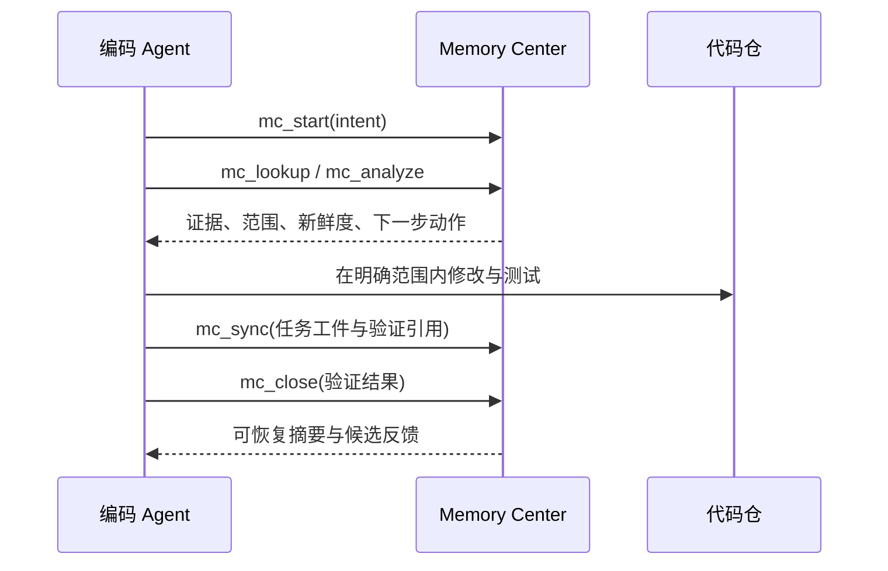
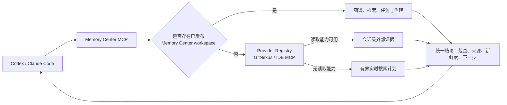

# Memory Center 技术架构与演进路线

> 面向架构评审、技术规划和项目介绍。本文以 `4.3.50` 已实现能力为准；规划项会明确标注为“后续方向”，不与现状混淆。
>
> English summary: a complete technical architecture and evolution narrative for a local-first, graph-first engineering context system for AI coding agents.
>
> **文档类型 / Document type：技术架构与演进路线。** 本文自包含地说明技术场景、架构取舍、核心机制、性能边界、安全治理、开源吸收策略和后续研究方向。

## 阅读路径：如何理解完整项目

这不是功能清单，而是一条完整的技术叙事：先说明为什么 AI 编程在复杂工程中失败，再解释如何把代码事实、检索、任务、验证和外部生态组织成闭环，最后说明哪些问题仍在研究、用什么指标决定是否值得上线。

| 阅读层次 | 建议关注重点 | 应建立的技术认识 |
|---|---|---|
| 快速概览 | 第 1、2 节 | 问题不是“模型不够聪明”，而是工程上下文缺少可靠结构与治理 |
| 核心实现 | 第 3 至 6 节 | 图谱、混合检索、任务状态和外部工具协同形成完整系统，而非单点 RAG |
| 工程保障 | 第 7 至 10 节 | 系统对可靠性、性能、安全和不确定性有可执行边界 |
| 演进决策 | 第 11 至 15 节 | 有明确技术选型、度量体系、研究路线和开源吸收方法，能持续演进 |

---

## 1. 开场：两分钟讲清楚

### 1.1 一句话定位

Memory Center 是一个面向 AI 编程助手的**本地优先工程上下文系统**。它把多仓、多服务代码中的结构、调用、契约、配置、任务过程和验证证据，组织成可重建、可检索、可解释、可治理的工程知识底座，并通过 MCP、CLI、HTTP 和 Workbench 提供给 Agent 与研发人员。

它不是聊天记录库，也不是单纯的向量数据库，更不是替代 IDE 的代码搜索工具。它解决的是：在复杂工程里，Agent 如何在不反复全局搜索、不把猜测当事实的前提下，可靠完成跨服务变更。

### 1.2 业务痛点

我把问题拆成五类：

| 问题 | 传统 Agent 的表现 | 造成的工程风险 | 系统做法 |
|---|---|---|---|
| 上下文断裂 | 新会话从头读代码 | 重复搜索、结论不一致 | Session、Task、Resume、Handoff |
| 跨服务链路不透明 | 找到一个 Controller 就停止 | 漏掉 Feign、MQ、DTO、配置调用方 | 静态事实图谱与有限深度链路展开 |
| 空结果被误读 | “搜不到”被当作“不存在” | 错误否定结论 | `knowledge_state`、范围和下一步动作 |
| 索引陈旧或更新太慢 | 全量重建阻塞工作 | 延迟高、结果过期 | generation、暂存发布、定向刷新 |
| 经验不受控 | 模型自评成功即沉淀 | 错误做法被复用 | 证据门槛、canary、发布与回滚 |

### 1.3 推荐的开场表达

> “我的核心设计不是让模型记住更多文本，而是把工程中可验证的事实提前建模：代码、接口、消息、配置和验证记录形成图谱。查询时先利用精确事实与图关系，再按需使用全文和语义召回；结论必须带证据范围、索引版本和可信状态。这样 Agent 的能力从临时搜索，变成可追溯的工程工作流。”

---

## 2. 总体架构：从代码到可控 Agent


### 2.1 分层与职责

| 层 | 核心职责 | 关键原则 |
|---|---|---|
| Workspace | 多项目范围、服务识别、规则、宿主接入 | 先定义边界，再索引 |
| Indexing | 文件、符号、Spring 语义、调用关系提取 | 事实提取与推断分离 |
| Storage | 图谱、倒排、向量、稀疏治理覆盖层 | 本地可重建、单一读写契约 |
| Retrieval | 查询规划、候选召回、融合排序、证据预算 | 精确事实优先，成本有界 |
| Orchestration | 影响分析、任务状态、交接、验证闭环 | Agent 使用任务接口而非底层细节 |
| Governance | 证据等级、断言状态、审计、发布门禁 | 不把不确定结论伪装成事实 |
| Adapters | MCP、CLI、HTTP、Workbench、Hooks | 四入口语义一致 |

### 2.2 数据面与控制面分离

这是架构中最重要的划分。

- **数据面**：图节点、图边、倒排/BM25、向量索引。这些内容服务查询，来源可重建。
- **控制面**：索引 generation、暂存发布、刷新任务、策略、断言覆盖、门禁和审计。它决定什么数据可以被读取、什么结论可以被提升。
- **经验面**：任务工件、验证回执、Skill 候选。它不能反向篡改静态事实，只能提供有证据的操作建议。

这样可以避免两个常见问题：一是把模型推断写成代码事实；二是把昂贵的索引维护放到查询热路径。

### 2.3 自研核心：不是重复实现基础设施

系统会复用 Tree-sitter、SQLite FTS、HNSW、Cross-encoder、MCP 等成熟能力；真正自研的是将这些能力变成适合工程 Agent 的统一工作流和可验证产品约束，而不是重新发明解析器或向量库。

| 自研核心 | 实现特点 | 解决的问题 |
|---|---|---|
| Generation 控制面 | staging 构建、质量检查、原子发布、旧版本可读 | 索引失败或刷新过程中不污染查询结果 |
| 工程事实图建模 | Spring 语义、Feign、MQ、配置、DTO、跨服务关系统一为实体和边 | 让“调用链”和“影响面”可计算、可解释 |
| 查询规划与证据预算 | 意图路由、硬锚点、图深度、候选上限、部分成功 | 不让语义检索淹没确定事实，也不让查询无界扩张 |
| 负向结论契约 | `knowledge_state`、范围、原因、下一步动作 | 防止“没有结果”被误解为“绝对不存在” |
| 证据与治理本体 | 事实、推断、歧义、验证、有效期、行动对象统一表达 | 模型建议不会直接升级为工程事实 |
| 热刷新闭包 | 内容哈希、路径变更、反向关联的一跳扩展、generation 发布 | 自动最新不等于每次全仓重建 |
| Provider Registry 与 EvidenceRef | 外部工具能力、权限模式、降级序列、临时证据引用统一建模 | GitNexus、IDE MCP、SCIP 等生态能力可接入而不破坏边界 |
| Skill 生命周期 | 候选、canary、观测、发布、回滚与验证证据绑定 | 将经验沉淀从提示词复制升级为可评测能力 |

---

## 3. 代码事实图谱：为什么不只做 RAG

### 3.1 实体与关系

系统将工程对象规范化为节点，例如：`Service`、`File`、`Class`、`Method`、`Field`、`Endpoint`、`FeignClient`、`FeignMethod`、`MQTopic`、`MQConsumer`、`ConfigKey`、`DataResource`。

关系表达真实工程约束，例如：

```text
Service --CONTAINS--> File --DECLARES--> Class --DECLARES--> Method
Controller --HANDLES_ENDPOINT--> Endpoint
FeignMethod --CALLS_SERVICE--> Endpoint
MQConsumer --CONSUMES_TOPIC--> MQTopic
Method --READS_CONFIG--> ConfigKey
Method --USES_DATA_RESOURCE--> DataResource
Method --CALLS_METHOD--> Method
```

图谱的价值不是“看起来很高级”，而是能回答关键词搜索无法稳定回答的问题：

- 这个 DTO 改动会影响哪些 Feign、Controller 和消费者？
- 这条请求从入口到下游服务、实现类、消息处理的链路是什么？
- 一个配置键在什么服务、什么方法被读取？
- 某个接口的调用方和被调用方是否跨项目？

### 3.2 解析器与置信度

Java/Spring 解析以 tree-sitter 为优先路径，并保留可诊断的降级能力。系统不会把静态调用分析当作绝对真相：每条调用候选可包含置信度和原因，用于区分明确解析、命名推断和歧义匹配。

技术上必须承认：静态分析对反射、动态代理、运行期拼接并不完备。因此系统把“静态事实候选”“推断”“运行时验证”分开表达，而不是承诺调用图 100% 完整。

### 3.3 事实、推断与验证

| 证据等级 | 含义 | 示例 |
|---|---|---|
| `EXTRACTED` | 从源码、配置或受控输入直接提取 | 注解路由、Feign 名称、Kafka topic |
| `INFERRED` | 根据图关系或规则推导 | 多跳影响范围、候选实现类 |
| `AMBIGUOUS` | 存在多个合理候选，不能自动裁决 | 同名方法、多 Controller 候选 |
| `VERIFIED` | 有验证证据支持 | 人工确认、受控测试、运行时兼容结果 |

结论还携带 `knowledge_state`：`FOUND`、`NOT_FOUND`、`UNKNOWN`、`NOT_INDEXED`、`STALE`、`REJECTED`。无结果只代表“在当前范围未发现”或“证据不足”，不能说“系统不存在这个影响”。

### 3.4 静态分析算法选型

代码理解不是单一解析器问题，而是“用多强的分析换取多少准确性和时延”的问题。当前系统以 tree-sitter 的语法树提取为主，并将无法精确决定的关系保留为候选。后续分析增强应遵循逐级加精度、按需付费的原则：

| 问题 | 当前适合的技术 | 为什么 | 研究增强 | 何时不该使用 |
|---|---|---|---|---|
| 文件、类、方法、注解提取 | Tree-sitter AST | 启动快、容错好、适合增量解析 | 语言 Server / SCIP 语义索引 | 不能用正则替代核心语法事实 |
| Spring Endpoint、Feign、MQ、配置 | 框架语义规则 + AST | 业务框架约束很强，可解释且低成本 | 符号解析和字节码补充 | 不应把命名相似当作确定调用 |
| 虚方法和接口调用 | 保守候选集 | 对 Java 多态安全，不虚构唯一目标 | CHA、RTA、points-to analysis | 不应在普通查询中跑全仓 points-to |
| 跨服务调用链 | 端点、Feign、消息、配置图连接 | 比纯方法调用图更贴近微服务真实边界 | Trace 对齐后的静态-运行时混合图 | 缺运行时证据时不能标记为 VERIFIED |
| 重命名与身份归并 | 带验证约束的别名关系 | 允许演进，又避免错误合并 | 基于 Git 历史和结构相似度的候选匹配 | 低置信候选不能自动合并 |

这里的核心工程判断是：**精确分析昂贵时，先返回保守候选、证据等级和下一步验证，而不是为了给出单一答案而伪造精度。**

---

## 4. 索引与新鲜度：如何避免又慢又旧

### 4.1 generation 发布模型

索引不直接覆盖正在服务查询的数据。一次重建遵循：

```text
扫描范围 -> 解析与写入 staging generation -> 质量检查
-> 原子激活为 published generation -> 查询读取新 generation
```

好处是：索引构建失败不会污染线上查询；查询永远读取一版完整可解释的视图；结果可以回溯到 generation。

### 4.2 变化感知与定向刷新

真实工程频繁变化，全量 reindex 放在每次查询前必然导致卡顿。Memory Center 的原则是：

1. 用变更路径判断是否可能影响索引。
2. 合并短时间内连续变化，去抖后按项目和路径定向刷新。
3. 查询先读取当前 published generation，并返回新鲜度。
4. 高成本全量重建只由显式命令或发布/基准任务触发。

因此“自动最新”不是每次都扫全仓，而是针对相关路径做最小必要刷新；当证据表明索引可能过期时，返回 `STALE` 和明确动作，而不是静默使用旧结论。

### 4.3 存储空间控制

图谱和索引是可重建派生物，不应该无限复制。当前设计将静态断言从图边按需派生，SQLite 断言侧车只保存人工验证、拒绝和治理等稀疏覆盖；语义内容只保存元数据，BM25/ANN 直接从专用索引读取。这样避免同一静态事实在图、JSONL 和断言表中多次全量复制。

当讨论“为什么本地索引会很大”时，关键结论是：大仓的关系边和向量天然有成本，正确方案不是删除事实，而是减少重复物化、隔离可重建派生物、提供压缩与 vacuum，并让向量只覆盖有价值的候选范围。

---

## 5. 检索算法：为什么是混合检索而不是单模型

### 5.1 查询规划先于检索

查询先根据意图生成有界计划，而不是对所有数据源盲目搜索。

| 查询类型 | 优先证据源 | 避免的无效成本 |
|---|---|---|
| 精确符号、接口、配置 | 图索引、符号索引、精确匹配 | 不启动向量检索 |
| 全链路分析 | 图遍历、调用与契约边 | 不用语义召回淹没主链路 |
| 自然语言定位 | BM25、稀疏语义、可选 dense | 保留精确命中锚点 |
| 索引过期 | 新鲜度检查、受限 live read | 不把旧索引说成最新 |

### 5.2 多路召回与融合

检索可组合以下来源：

- 图结构：最适合调用、依赖、配置、消息等确定关系。
- 精确匹配：最适合类名、方法名、接口路径、topic、配置键。
- SQLite FTS/BM25：最适合技术名词和自然语言中的稀疏关键词。
- 可选本地 dense vector：补足表达差异。
- 可选重排：仅用于有限候选的精排，不能覆盖精确事实锚点。

排序遵循“硬约束优先、学习权重只做轻量校准”：精确命中和完整链路所需的图证据不能被语义得分淘汰；历史 replay 的学习结果必须有验证证据，且只能在预设范围内调整权重。

### 5.3 ANN 与性能取舍

小规模向量可以暴力余弦计算，但大索引下复杂度会线性增长。系统可使用 HNSW ANN 索引，将 dense 召回与 Python 暴力回退分开；ANN 缺失时必须在诊断中显式表明降级，不能伪装为同样性能。

这部分可用一句话概括：**图解决确定性，BM25 解决术语，向量解决表达差异，ANN 解决规模，重排解决有限候选的顺序。**

### 5.4 算法选型矩阵：每一层为什么这样选

| 层级 | 当前优选算法或技术 | 选择理由 | 不采用或不作为默认的方案 |
|---|---|---|---|
| 查询意图识别 | 规则优先的轻量分类与显式模式 | 符号、链路、影响分析意图高度结构化，毫秒级且可解释 | 直接让大模型为每次查询规划，成本高且不可重复 |
| 精确召回 | 倒排、符号索引、前缀与规范化匹配 | 类名、方法、路径、topic、配置键属于强约束实体 | 仅依赖 embedding，容易丢失专有名词和方向 |
| 文本召回 | SQLite FTS / BM25 | 稀疏术语稳定、索引紧凑、本地部署简单 | 单纯 n-gram 扫描，查询成本随仓库线性增长 |
| 语义召回 | 选择性 dense embedding + HNSW | 解决中文描述与代码术语表达差异，并保持近似对数级候选访问 | 全节点 embedding 和 Python 暴力余弦，空间与时延不可控 |
| 融合排序 | 硬约束保留 + 可解释权重融合 | 确保图事实和精确命中不会被语义得分挤掉 | 黑盒学习排序直接覆盖所有结果 |
| 有限候选精排 | Cross-encoder reranker | 在 Top-K 内判断查询与候选的细粒度相关性 | 对全库重排，吞吐和延迟无法接受 |
| 链路搜索 | 有界 BFS / 双向 BFS | 路径问题可解释，复杂度可按深度和边数控制 | 无界 DFS，容易在共享依赖节点爆炸 |
| 影响排序 | 规则分层 + 图中心性、距离和证据权重 | 将直接影响、跨服务影响、候选影响明确分层 | 只按节点度数排序，容易放大公共基础类 |

融合分数应当是受约束的，而非神秘公式：

```text
final_score = hard_anchor
            + w_exact * exact_score
            + w_graph * graph_proximity
            + w_bm25 * sparse_score
            + w_dense * dense_score
            + w_rerank * rerank_score
            - stale_penalty
            - ambiguity_penalty
```

其中 `hard_anchor` 不是连续分数，而是“精确符号、已验证关系、主链路必经节点不得被淘汰”的硬规则。权重只能由脱敏 replay 与验证结果校准；没有足够 replay 时，保留人工可读的默认权重比引入学习排序更可靠。

### 5.5 从启发式到学习排序的研究边界

学习排序并不是越早越好。真正值得引入 LambdaMART、pairwise ranking 或 contextual bandit 的前提是：同类任务已有足够的脱敏 query、候选、人工选择、验证结果和失败样本。否则模型学到的只是历史 Agent 的偏好，甚至放大错误。

建议的演进顺序：先建立 replay 数据集和离线指标，再做离线权重搜索；稳定后以 shadow 模式比较学习排序与基线；只有在召回、误命中、P95、Token 和验证成功率同时达标时才灰度启用。线上实时探索不应直接改变默认检索路径。

---

## 6. Agent 工作流：把工具调用变成可恢复的任务

### 6.1 MCP 任务级接口

核心入口不是暴露一堆存储 API，而是提供稳定任务动作：

```text
mc_start     创建会话，读取规则与工作区上下文
mc_lookup    统一检索，自动选择合适模式
mc_analyze   变更前影响分析、规则、契约与验证清单
mc_sync      长任务同步任务空间
mc_resume    中断后恢复有界上下文
mc_handoff   模型或会话切换时生成交接包
mc_close     关闭会话并关联验证、候选反馈
```

典型开发流程：



### 6.2 任务与记忆的四层模型

| 层级 | 保存什么 | 为什么存在 |
|---|---|---|
| L0 会话事件 | 脱敏工具调用摘要、时间线 | 可回放、可审计 |
| L1 经验原子 | 已验证、可复用案例 | 复用解决方式而不是对话全文 |
| L2 任务空间 | context、design、plan、test-plan、变更记录 | 支持长任务恢复与交接 |
| L3 工作区画像 | 团队规则、架构不变量、迁移策略 | 跨任务稳定约束 |

核心任务工件默认追加写入，避免 Agent 一次输出覆盖人工积累的设计或验证记录。

### 6.3 受控交付与 Skill 演进

`feature_delivery_v2` 把需求交付组织为有界状态机：

```text
intake -> breakdown -> locate -> implement -> verify -> close
```

关闭需要执行器证据或有引用的人工验证。执行器只接受 workspace 维护者预注册的 argv profile，绝不执行模型从需求正文中拼出的 shell 字符串。

经验沉淀同样有门槛：

```text
已验证交付 -> Skill candidate -> canary
-> 达到契约最低样本数（默认三条）的成功且有证据观测 -> published
-> 发现回归 -> rolled_back
```

这回答了一个关键治理问题：如何让 Agent 自我改进但不把错误经验快速扩散。

### 6.4 外部工具协同：不替代生态，而是统一编排生态

现实中，编码 Agent 可能已经具备 GitNexus、IDE 索引、测试执行器、Skill、MCP Server 或企业内部工具。Memory Center 不应要求它们全部被重写，而应担任**工程上下文控制面**：识别当前可用能力，选择成本最低且证据最可靠的路径，并把外部结果统一成可解释的证据。

当前已落地的协同路径如下：



它解决了一个实际体验问题：新项目尚未初始化 Memory Center 时，Agent 不必先执行全量索引才能开始理解代码；如果宿主已全局接入 Memory Center MCP，它可以先调用 `mc_bootstrap_context`。该入口按以下优先级工作：

1. 向上发现已有 `.memory-center/workspace.yaml`，存在则直接使用已发布 generation。
2. 不存在时通过 Provider Registry 调用 GitNexus 的固定 `status`、`query`、`context`；也可通过受限 MCP Client Bridge 直接调用策略登记的 IDEA MCP、GitNexus MCP 等 HTTP 工具，只取得当前会话可用的结构化线索。
3. 所有外部读取能力不可用、未索引或超时时，返回有界 `rg` 实时搜索计划，而不是静默失败或触发隐式全量索引。

这一机制的重点不是“多调一个工具”，而是明确外部能力的身份：GitNexus 提供局部代码导航、影响分析和索引维护；IDEA MCP 提供 IDE 语义、文件与运行配置能力；Memory Center 提供跨服务事实图、任务连续性、验证治理和长期可重建记忆。它们是分层互补关系，不是互相覆盖。

| 协同对象 | 当前协同方式 | Memory Center 统一的内容 | 不允许发生的事 |
|---|---|---|---|
| GitNexus | 固定动作 Provider：读取、影响、链路、变更检测、受控索引与清理 | provider、检查范围、耗时、观测时间、临时证据、下一步动作 | 任意 argv、任意 shell、外部正文直接写入图谱 |
| IDEA MCP | 宿主直接工具调用，或通过受限 MCP Client Bridge 直连已登记 HTTP MCP | IDE 语义、文件定位、重构建议、运行配置结果 | 未声明工具 schema、无确认的写入或运行配置 |
| Skill | 已验证交付产生候选，经 canary、观测、发布或回滚演进 | 生命周期、结构签名、验证引用、适用边界、效果指标 | 模型自评后直接发布、未验证经验覆盖事实 |
| Hooks | 宿主会话开始、结束、代码变化时触发受限动作 | session 关联、变更提示、定向刷新建议、审计摘要 | 在查询热路径执行全量重建或收集原始对话正文 |
| MCP / CLI / HTTP / Workbench | 多入口调用同一应用服务 | 相同状态转换、证据等级、负向结论与 Action 语义 | 因入口不同而出现不同的事实或治理规则 |
| 测试和交付执行器 | 预注册 argv profile 的受控执行 | 验证状态、回执、失败原因、发布门禁 | 根据需求文本或模型输出拼接 shell |

外部读取证据默认是**会话级、临时且不可反向污染知识图**。当前 GitNexus 读取结果最多缓存 30 秒，不写入 `.memory-center`、SQLite、图谱或 MCP 审计日志。受控动作则通过固定契约返回状态与证据摘要：读取动作可直接运行，索引和清理必须显式确认。只有经过明确验证的结论，才可以通过既有断言、验证和 Skill 生命周期进入长期治理层。

### 6.5 为什么不直接让 Agent 自由调用所有工具

> “Agent 工具越多，不等于工程能力越强。没有统一边界时，工具会产生互相冲突的索引、不可追溯的结论和不可控的副作用。我的做法是把外部工具视为可插拔的证据 Provider 或受控执行器：Provider 默认只读、限时、限量、带来源；执行器必须有固定 profile 和验证回执。Memory Center 不抢占工具能力，而是统一工具之间的事实、上下文和治理语义。”

这个取舍同时改善性能和体验：已初始化项目走低延迟的已发布索引；未初始化项目走零写入的外部导航；真正需要长期任务、跨服务影响和可验证沉淀时，才由用户显式初始化。这样不会把几十 GB 的索引构建塞进一次普通链路分析。

### 6.6 已实现：Provider Registry、跨 Provider EvidenceRef 与融合

外部能力不能以散落的 `if/else` 或任意命令调用接入。系统已经提供 Provider Registry：每个 Provider 声明能力、优先级、超时、结果上限、写入模式和隐私模式；查询根据 `code_navigation` 等能力选择 Provider，记录每次尝试和降级序列，并将其返回为 `provider_selection`。具体动作仍分别受 `read_only`、`controlled_write` 与 `destructive` 门禁约束。

跨 Provider 结果同时生成统一的临时 `EvidenceRef`：它有稳定引用 ID、Provider、证据等级、关系模式、检查范围、观测时间、耗时、正文哈希、持久化边界和验证状态，但不携带外部正文。这样 GitNexus、未来的 SCIP 或 IDE Provider 可以共享同一证据语言，而不会把工具输出直接混入图谱或长期记忆。

融合层只接受脱敏引用和 Provider 显式给出的 `claim={subject,predicate,value}`，不会从工具正文、文本相似度或哈希差异猜测语义。同一 Claim 的多 Provider 同值为 `CONSISTENT`，异值为 `CONFLICT` 并生成 `verify_conflict` Action；无 Claim、无第二独立来源时为 `INSUFFICIENT_EVIDENCE`。这让“多个工具返回不同内容”保持可解释，而不把工具拼接变成不可靠的自动结论。

### 6.7 已实现：受限 MCP Client Bridge 与后续生态方向

Memory Center 已可作为受限 MCP Client，不再只能由宿主 Agent 分别调用外部 MCP。工作区维护者通过 `.memory-center/provider-mcp-policy.json` 显式声明 Provider、HTTP URL、`sse|streamable_http` transport、允许的工具与 `{query}` / `{target}` 参数模板；Bridge 建立 MCP 会话后先 `list_tools`，再 `call_tool`。这使 IDEA MCP、GitNexus MCP 等能力可保留结构化参数与工具版本，同时仍受超时、结果上限、确认门禁和临时证据边界约束。

Bridge 不支持 stdio、自由工具/参数、认证字段或任意命令，避免 Memory Center 成为未经治理的远程执行代理。外部输出不进入图谱、SQLite、断言和审计存储；成功调用只形成不含正文的会话级 `EvidenceRef`。`read_only` 可直接读取，`controlled_write` 与 `destructive` 一律需要明确确认。声明 `capabilities: [code_navigation]` 的只读 Bridge 工具会动态加入现有 Provider Registry，和 GitNexus 共同使用 P95、错误率、成本分和静态优先级路由；失败或超时只影响后续选择，不触发后台探测或仓库扫描。

以下是尚未交付的后续方向：

以下是明确的后续方向，不是当前已交付能力：

| 方向 | 可实现机制 | 预期收益 | 前置约束 |
|---|---|---|---|

已交付的 Provider 健康路由以进程内调用窗口计算 P95、错误率和成本分，不做后台扫描；Bridge 动态 Provider 与 GitNexus 共用该路由；GitNexus 明确未索引或陈旧时会生成确认型 `analyze --index-only` 行动卡，不会自动执行。Skill Contract 与脱敏 replay 集已进入 candidate/canary/published 生命周期：只有声明语言、适用前置、停止条件、输入输出字段并积累真实验证 replay 的 Skill 才能发布。下一优先级是根据真实回放校准融合可信排序与 Skill 推荐质量。

---

## 7. 影响分析与可靠性：最容易被忽略的工程难题

### 7.1 分阶段影响分析

`mc_analyze` 不把所有能力绑成一个原子黑盒。它先获取图谱影响，再补充计划、规则、契约检查和验证清单。后续辅助阶段失败时，已获得的图谱证据仍保留，并返回 `analysis_status="partial"`、诊断和下一步动作。

这个设计避免了典型事故：明明已经找到 20 个影响调用方，却因为一个可选检查异常而对用户只返回“内部错误”。

### 7.2 负向结论契约

任何“未发现”结论都应包含：

- `absence_reason`：为什么没有结果。
- `scope_checked`：检查过哪些项目、路径、generation 和查询模式。
- `next_action`：是缩小/扩大范围、刷新索引，还是请求人工验证。

这让接口、CLI、HTTP、MCP 与 Workbench 对空结果保持一致，不依赖调用者自行猜测。

### 7.3 身份与别名

服务或符号重命名时，系统可以表达 `ALIAS_OF`、`SAME_AS`、`RENAMED_FROM`、`REPLACES`。只有带验证证据的等价关系才参与默认归并；低置信、循环或“替代而非等价”的关系只提示，不自动合并。结果会返回 `identity_resolution`，说明原始实体、规范实体、依据和歧义。

这在大规模重构、服务迁移和历史命名混用时很重要：方便查询而不制造错误同一性。

---

## 8. 性能工程：怎样证明它能用

### 8.1 热路径约束

性能设计不是“先做出来再优化”，而是为热点设置明确禁止项：

1. 普通查询只读取已发布 generation。
2. 查询不触发全量扫描、全量 reindex 或隐式模型下载。
3. 图遍历限制深度、边数、候选数和输出体积。
4. 向量、重排、社区分析、失败聚类等高成本动作只在需要时运行。
5. 大型审计 JSONL 采用保留窗口和后台压缩，不能阻塞 MCP 调用线程。

### 8.2 可执行门禁

系统的性能结论应基于真实 workspace 的可重复 workload，而不是宣传数字。门禁关注：

- 默认查询 P50/P95。
- 局部 refresh 相对于基线的额外开销。
- 显式全量 reindex 的额外开销。
- 历史查询条数上限和全局审计 SQL 聚合限制。
- 索引规模、命中率、误命中、Token 与验证成功率。

基准应在临时索引目录运行同一 workload 的基线与增强对照，不能改写用户正式 generation。

### 8.3 性能设计的核心表达

> “我的优化不是只看单次查询耗时，而是区分热路径与维护路径。热路径读取已发布索引，维护路径负责解析、向量构建、压缩和评测。再用真实工作区 workload 比较 P95、召回、Token 和验证结果，避免为了低延迟把关键图证据裁掉。”

---

## 9. 安全与隐私：为什么适合私有研发环境

### 9.1 基本原则

- 默认本地优先，不要求上传源码或对话正文。
- MCP 审计只保存脱敏参数摘要、耗时、状态和规模，不保存完整请求/响应。
- 审计默认保留最近 30 天，最多 100,000 条；会话事件与摘要有分层生命周期。
- 错误对外返回安全诊断与 trace ID，不泄露绝对路径、密钥、堆栈和业务正文。
- 运行时契约样本只接收受限元数据，不接收 request body、header 或消息正文。
- 自动执行仅允许受审核的 argv profile，禁止自由 shell。

### 9.2 重要边界

本地优先不等于“写到磁盘就安全”。仍需要工作区权限控制、索引目录备份策略、排除规则、脱敏策略和操作审计。系统负责数据最小化和技术边界，企业仍需按自身安全规范管理主机、仓库与访问权限。

---

## 10. 架构哲学：为什么这样设计

Memory Center 面对的不是单纯的“如何召回更多上下文”，而是如何让不完整信息下的自动化行为保持可解释、可验证和可逆。以下思想都落实到系统的具体约束中。

| 思想 | 工程化落实 | 解决的问题 |
|---|---|---|
| 本体论 | 显式区分代码实体、任务、会话、断言、验证、决策、策略与行动，并校验关系端点 | 避免把任务记录、代码事实、模型建议混为同一种数据 |
| 认识论 | `EXTRACTED / INFERRED / AMBIGUOUS / VERIFIED` 与 `knowledge_state` | 避免“没搜到”或“模型推断”被伪装成工程事实 |
| 控制论 | `检测/查询 -> 决策 -> 执行 -> 验证 -> 反馈 -> 回滚` 闭环 | 防止 Agent 只能生成代码、不能证明正确或从失败中受控改进 |
| 有界理性 | 查询预算、候选上限、图深度、热路径隔离、部分成功 | 防止为了追求全知而引发超时、无界扫描或错误扩大化 |
| 最小知情 | 脱敏审计、引用而非正文、保留期、受控 argv 执行 | 降低私有源码、对话和验证日志的二次暴露风险 |
| 演化式架构 | generation、适配层、特性开关、基准、门禁与回滚 | 避免将某个模型、向量库或开源框架固化为不可替换的核心 |

可以用一个公式总结：

```text
可信工程结论
= 已发布且可重建的事实
+ 有界推理与检索
+ 任务范围与验证证据
- 未经验证的模型臆测
```

## 11. 开源项目借鉴

Memory Center 的策略不是重复造轮子，而是持续吸收成熟项目的闪光点，并结合真实工作区验证后再演进。

| 能力方向 | 代表项目 | 借鉴闪光点 |
|---|---|---|
| 代码上下文 | Aider Repo Map、Tree-sitter、SCIP、GitNexus | 代码地图、AST 解析、跨语言符号索引、调用与影响图导航 |
| 长期记忆 | Mem0、Letta | 分层记忆、Memory Block、跨会话状态维护与记忆评测 |
| Agent 编排 | LangGraph、OpenHands | 长任务状态机、恢复、人类确认、Agent 执行轨迹与隔离 |
| 图检索 | Microsoft GraphRAG | 局部/全局问题分层、社区摘要和图增强检索 |
| 向量检索 | Qdrant、HNSW、Cross-encoder Reranker | dense/sparse 混合检索、近似最近邻和有限候选精排 |
| Agent 评测 | Alibaba Skill-Up、SWE-bench、SWE-agent、DeepEval | 用真实任务、测试和工具调用结果评估 Agent，而非只看模型自评 |
| 安全评测 | Promptfoo | 提示词测试、红队用例、CI 集成和负向场景覆盖 |
| 可观测性 | Phoenix、OpenTelemetry | Agent/检索/工具调用链路的 Trace、指标、数据集和实验对比 |

核心原则是：成熟的解析、向量、评测和可观测性能力优先借鉴或适配；代码事实、证据等级、任务治理、隐私边界和多入口一致性仍由 Memory Center 统一定义。

## 12. 高频追问与标准回答

### 12.1 “为什么不用纯向量 RAG？”

纯向量检索擅长语义相近，但对方法名、接口路径、配置键、消息 topic 和调用方向等工程事实不稳定，也难解释影响链路。Memory Center 用图谱和精确匹配作为确定性底座，向量只是自然语言召回的补充。

### 12.2 “为什么不用 Neo4j 或云向量数据库？”

系统的目标是本地优先、零额外服务、每个 workspace 可独立携带和重建。SQLite 在这个规模和部署模型下能统一承载关系、全文、运行记录与治理元数据。若未来出现跨团队集中图分析或超大规模并发需求，可以通过稳定的读写契约演进存储实现，而不是让上层业务绑定某个数据库。

### 12.3 “如何处理索引不准？”

不把静态分析说成绝对真相。每条结论带 evidence level、confidence、generation 和 scope；歧义明确返回 `AMBIGUOUS`；关键变更要求验证清单或运行时契约证据；索引过期返回 `STALE`，不会默默掩盖。

### 12.4 “如何防止 Agent 执行危险命令？”

受控执行器只运行维护者登记的固定 argv profile，需求文本和模型输出不能直接成为 shell。状态转换、审计和验证证据通过同一个应用服务入口处理，入口不同但治理语义一致。

### 12.5 “索引几十 GB 是否合理？”

先拆解占用：图边、倒排、向量、历史工件和重复物化的占比不同。静态事实应只保留一个可重建主来源，其他读模型按需派生；向量应选择性覆盖；历史数据要有保留窗口；维护后执行 compact/vacuum。空间优化不能以牺牲事实追溯和查询热路径为代价。

### 12.6 “你如何衡量项目成功？”

不能只看“Agent 调用了多少次”。要同时看：查询 P95、索引增量成本、准确召回、误命中、Agent 是否按建议读取目标、变更后验证成功率、人工介入率以及发布门禁通过率。并且这些指标必须来自真实 workspace 的 replay 或受控基准。

---

## 13. 后续研究路线：不是堆技术，而是逐步减少不确定性

当前成熟度最高的是 Java/Spring 服务关系和契约索引；其他语言以通用结构索引为主。静态调用图无法完全覆盖反射、动态代理和运行期拼接，因此关键路径仍需要运行时或人工验证。真实 workspace 的质量与性能，需要持续积累脱敏 replay 才能校准融合权重。

### 13.1 研究总图


### 13.2 P0：先建立可重复的真实基线

研究的第一步不是换模型，而是建立脱敏 replay：记录意图类别、查询计划、候选集合、最终读取目标、验证结果、P50/P95、Token、外部工具降级和人工介入。基线数据允许回答三个问题：哪类任务最慢、哪类关系最容易误判、哪一层召回真正帮助了验证。

| 指标 | 衡量什么 | 决策用途 |
|---|---|---|
| Recall@K / MRR / nDCG | 目标符号或证据是否进入前 K | 判断检索算法是否值得替换 |
| 路径覆盖率 / 路径精度 | 真实调用链是否被找出、是否引入噪声边 | 判断静态图和运行时补充价值 |
| P50 / P95 / P99 | 用户感知的稳定性，而非偶然最快值 | 保护查询热路径 |
| Token-to-verified-change | 每个验证通过变更消耗的上下文与模型输出 | 衡量 Agent 工作流效率 |
| 人工纠正率 / 误导率 | 系统是否让人更快或更慢 | 决定是否扩大自动化范围 |

### 13.3 P1：静态图、增量索引与检索校准

这一阶段的目标是提高“代码里本来就存在的事实”的覆盖与准确性。

| 研究项 | 推荐方法 | 验证标准 | 风险控制 |
|---|---|---|---|
| Java 多态调用 | CHA -> RTA -> 按需 points-to 的逐级分析 | 候选集缩小且不降低真实调用覆盖 | 高成本分析只离线或定向运行 |
| 跨语言索引 | SCIP / LSP 符号事实作为 Provider 或导入源 | 符号跳转和引用准确率提升 | 不把语言服务缓存当成永久事实 |
| 增量图更新 | 内容哈希、依赖反向边、变更闭包 | 局部刷新成本相对全量显著下降 | 失败时保留旧 generation 并显式 STALE |
| 语义检索校准 | BM25F 字段加权、HNSW 参数搜索、离线融合权重 | Recall@K 与 P95 同时改善 | 不允许 dense 覆盖精确锚点 |
| 路径解释 | 最短路径 + 证据权重 + 关键节点约束 | 解释可读且主链路稳定 | 限制跳数、边数和输出预算 |

### 13.4 P2：静态-运行时证据融合

下一步不是把所有运行日志倒进图数据库，而是只接收最小化的运行时契约：路由、服务标识、方法或消息名、状态码、耗时、版本与时间窗口。静态边与运行时证据按双时间模型保存：事件发生时间说明“何时发生”，观测时间说明“何时被系统看到”。

融合算法可以采用证据加权而非简单覆盖：静态 AST 事实提供基础置信度；受控测试、灰度流量或人工确认提高置信度；版本不匹配、超时窗口或冲突证据降低置信度并返回 `AMBIGUOUS`。这比“运行日志出现过一次就认定永久调用关系”更符合真实分布式系统。

### 13.5 P3：外部生态与 Agent 能力进化

Provider Registry 已解决外部工具的声明、能力路由、调用健康与受控动作边界；受限 MCP Client Bridge 已补齐直接 HTTP MCP 协同与策略门禁；跨 Provider Claim 冲突检测、Skill Contract 与脱敏回归集也已接入。下一阶段只应基于真实回放校准融合排序和推荐质量，而非在缺乏证据时增加自动化策略。

Skill 已被建模为“有适用语言、前置/停止条件、输入输出契约、脱敏 replay、验证集和回滚条件”的可执行知识单元。候选 Skill 仍采用保守的规则匹配和结构相似度召回，并按请求语言过滤；当真实 replay 足够时，再研究 contextual bandit 在“选择哪个已发布 Skill”上的探索，但发布决策仍必须由验证证据驱动。

### 13.6 P4：规模化存储与跨工作区协作

SQLite 是单工作区、本地优先和低运维的合理默认，并不意味着永久排斥其他后端。当并发、跨团队查询、索引规模或集中治理超过本地单机边界时，可以将图读模型、向量 ANN、审计分析和对象存储逐步拆分，但必须保留统一实体 ID、EvidenceRef、generation、读写契约和本地离线可用能力。

不建议一开始就迁移到分布式图数据库。先通过分层归档、选择性向量化、边压缩、冷热数据分离、增量 generation 和真实 P95 基准确认瓶颈，再决定是否需要外部存储服务。

### 13.7 研究项目的上线门槛

任何研究能力上线前都要经过同一关卡：离线 replay 优于基线、真实 workspace P95 不退化、无证据 VERIFIED 为零、隐私边界未放宽、出现回归时可一键关闭或回退。算法先进不等于产品可用；在工程 Agent 中，可解释、可验证、可回退通常比单点最高分更重要。

---

## 14. 技术选型总表

| 领域 | 首选技术 | 为什么 | 替代条件 |
|---|---|---|---|
| 语法解析 | Tree-sitter | 本地、快速、增量友好、跨语言扩展性好 | 需要语义级引用时接入 SCIP/LSP |
| 代码事实 | SQLite 图读模型 + generation | 无额外服务、可重建、原子发布、便于携带 | 跨团队高并发和超大图规模 |
| 文本检索 | FTS / BM25 | 专有名词和稀疏术语稳定、成本低 | 语义表达差异显著时叠加 dense |
| 语义检索 | 选择性 embedding + HNSW | 控制空间与查询延迟 | 候选量很小时可省略 ANN |
| 图路径 | 有界 BFS / 双向 BFS | 调用链可解释、预算可控 | 结构洞和影响传播研究可补充 PPR |
| 精排 | Top-K Cross-encoder | 精度高且成本被候选上限控制 | 延迟预算不足时关闭 |
| 任务编排 | 显式状态机 | 可恢复、可审计、可限制状态转换 | 简单只读查询不进入状态机 |
| 外部协同 | Provider Registry + EvidenceRef | 可插拔、可降级、来源统一 | 高成熟生态后接入受限 MCP Client |
| 自动执行 | 固定 argv profile | 防止模型输出成为 shell | 无预注册验证命令时仅给出建议 |
| 评测 | Replay + 真实验证回执 | 衡量真实工程收益 | 没有样本前不做学习排序和自动发布 |

---

## 15. 项目总结

> “Memory Center 的创新点不是单点算法，而是把工程事实、检索、任务状态、验证证据和治理门禁串成一个闭环。它让 Agent 在复杂私有代码库里先基于已发布、可追溯的上下文做事，再通过验证决定哪些经验可以复用。核心取舍是宁可明确表达不确定，也不让系统以高置信语气输出未经验证的结论。”
